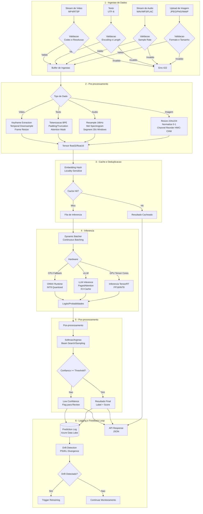

# Diagrama de Fluxo de Dados

## Visao Geral

Fluxo completo dos dados desde a ingestao bruta (imagens, textos, audio) ate a predicao final, detalhando as transformacoes e pontos de decisao que impactam latencia em cada etapa.

## Fluxo de Dados — Ingestao ate Predicao

## Fluxo de Dados de Treinamento e Otimizacao

```mermaid
flowchart LR
    subgraph "Coleta"
        RAW[Raw Data] --> LABEL[Labeling Tool]
        LABEL --> STORE[(Data Lake<br/>DVC Versioned)]
    end

    subgraph "Preparacao"
        STORE --> SPLIT[Train/Val/Test<br/>Stratified Split]
        SPLIT --> AUG[Data Augmentation<br/>Albumentations/NLPAug]
        AUG --> FEAT[Feature Engineering<br/>Embeddings Pre-computados]
    end

    subgraph "Treinamento"
        FEAT --> TRAIN[Training<br/>PyTorch + AMP FP16]
        TRAIN --> EVAL[Evaluation<br/>Accuracy + Latency P95]
        EVAL --> PEFT_FT[PEFT Fine-tuning<br/>LoRA/QLoRA]
    end

    subgraph "Otimizacao"
        PEFT_FT --> PRUNE[Pruning<br/>Structured]
        PRUNE --> QUANT[Quantization<br/>PTQ INT8 / QAT]
        QUANT --> DISTILL[Knowledge Distillation<br/>Teacher-Student]
        DISTILL --> EXPORT[Export<br/>ONNX/TorchScript/TFLite]
    end

    subgraph "Registry e Deploy"
        EXPORT --> BENCH[Benchmark<br/>Latency P50/P95/P99]
        BENCH --> REG[(Model Registry<br/>MLflow)]
        REG --> DEPLOY[Deploy<br/>Triton/vLLM/KServe]
    end
```

## Metricas por Etapa do Fluxo

| Etapa | Metrica Principal | Alvo | Formato de Dado |
|-------|------------------|------|-----------------|
| Ingestao | Throughput (req/s) | > 1000 | Raw binary |
| Validacao | Rejection rate (%) | < 5% | Raw binary |
| Pre-processamento | Latencia (ms) | < 20ms | Tensor float32/float16 |
| Cache Lookup | Latencia (ms) | < 1ms | Hash key |
| Dynamic Batching | Batch fill rate (%) | > 80% | Tensor batch |
| Inferencia GPU (CV) | Latencia P95 (ms) | < 50ms | Tensor float16/int8 |
| Inferencia LLM | TTFT (ms) | < 300ms | Token sequence |
| Inferencia CPU | Latencia P95 (ms) | < 200ms | Tensor int8 |
| Pos-processamento | Latencia (ms) | < 5ms | JSON |
| **Total E2E** | **Latencia P95** | **< 100ms (CV)** | **JSON** |
