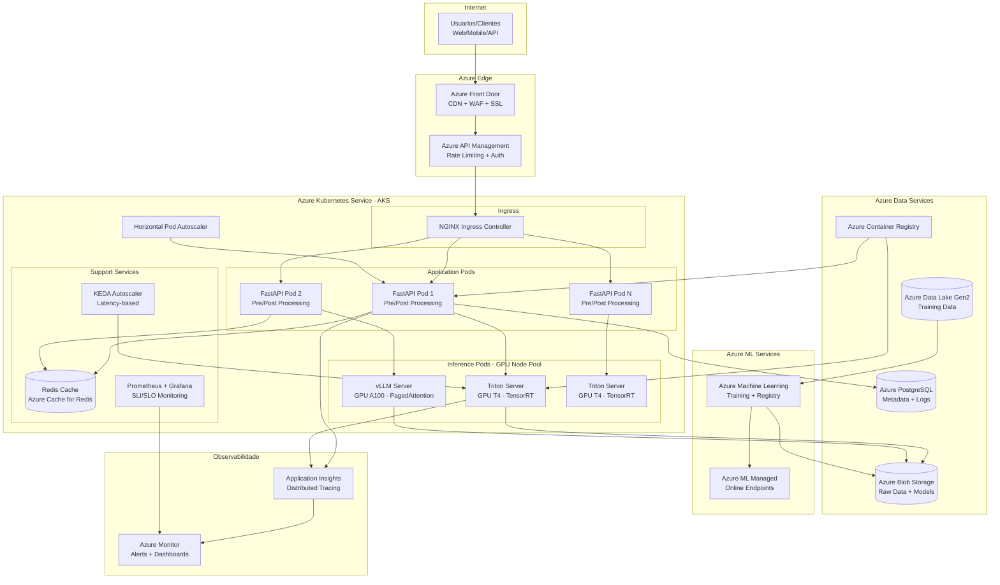
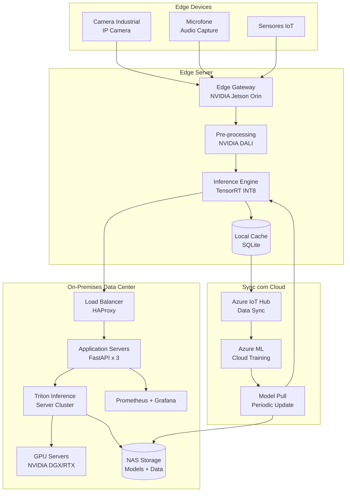
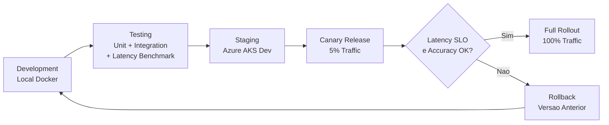

# Diagrama de Deployment

## Visao Geral

Opcoes de deployment para sistemas de inferencia de ML com dados nao estruturados, cobrindo cenarios cloud (Microsoft Azure), on-premises e edge. O foco esta na topologia que minimiza latencia enquanto mantem escalabilidade e resiliencia.

## Deployment em Cloud — Microsoft Azure

## Deployment On-Premises / Edge

## Comparacao de Ambientes

| Aspecto | Cloud (Azure AKS) | On-Premises | Edge (Jetson/NPU) |
|---------|-------------------|-------------|---------------------|
| **Latencia de rede** | 10-50ms (com CDN) | < 5ms (LAN) | < 1ms (local) |
| **Latencia de inferencia** | 20-50ms (GPU T4/A100) | 20-50ms (GPU dedicada) | 30-100ms (TensorRT INT8) |
| **Escalabilidade** | Elastica (KEDA/HPA) | Limitada (capacidade fixa) | Fixa (por device) |
| **Custo** | Pay-as-you-go (OpEx) | CAPEX alto, OpEx baixo | CAPEX moderado |
| **Disponibilidade** | 99.95% (SLA Azure AKS) | Depende de infra local | Offline-first |
| **Modelos suportados** | Qualquer tamanho | Qualquer tamanho | Otimizados (INT8/INT4) |
| **Manutencao** | Gerenciada (PaaS) | Equipe interna | Atualizacao OTA |

## Estrategia de Deployment — CI/CD

## Requisitos de Infraestrutura

### Ambiente de Desenvolvimento
- Docker Desktop com GPU support (opcional)
- Python 3.10+ com venv
- 16GB RAM, 4 CPU cores minimo
- GPU NVIDIA com CUDA 12.0+ (recomendado)

### Ambiente de Staging
- Azure AKS com 1x GPU node (T4)
- Azure Cache for Redis (Basic)
- Azure Blob Storage (Hot tier)
- Azure ML Workspace

### Ambiente de Producao
- Azure AKS com GPU node pool (T4/A100, autoscaling 2-10 nodes)
- Azure Front Door (WAF enabled)
- Azure Cache for Redis (Premium, clustered)
- Azure Data Lake Storage Gen2
- Azure Monitor + Application Insights
- Azure ML Managed Online Endpoints (alternativa ao AKS)
