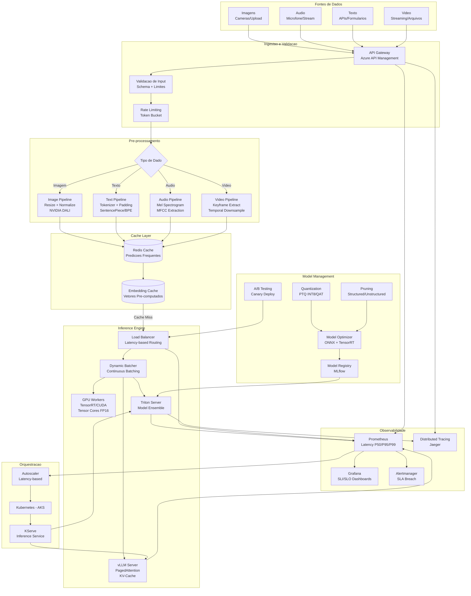

# Diagrama de Arquitetura de Sistema End-to-End

## Visão Geral

Este diagrama representa a arquitetura completa do sistema de ML para dados não estruturados, desde a ingestão de dados brutos até a entrega de predições ao usuário final, com foco nos componentes que impactam latência em cada etapa.

## Arquitetura de Sistema

## Budget de Latencia por Componente

| Camada | Componente | Latencia Alvo | SLA |
|--------|-----------|---------------|-----|
| API Gateway | Azure API Management + WAF | < 5ms | 99.99% |
| Validacao | Schema validation + rate limiting | < 2ms | 99.99% |
| Pre-processamento | Resize/Tokenize/MFCC (GPU DALI) | < 20ms | 99.95% |
| Cache | Redis lookup | < 1ms | 99.99% |
| Load Balancer | Latency-based routing | < 1ms | 99.99% |
| Inferencia (GPU) | TensorRT FP16/INT8 | < 50ms | 99.9% |
| Inferencia (LLM) | vLLM PagedAttention | < 200ms | 99.5% |
| Pos-processamento | Decode + format | < 5ms | 99.95% |
| **Total E2E (CV/Audio)** | **Request to Response** | **< 100ms** | **99.9%** |
| **Total E2E (LLM)** | **Request to First Token** | **< 300ms** | **99.5%** |
