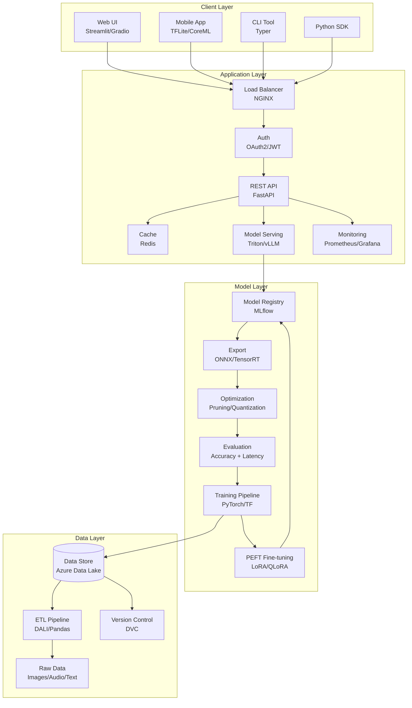
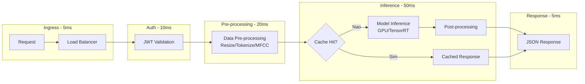

# Arquitetura da Solução

## Visão Geral

A arquitetura das soluções desenvolvidas nesta disciplina segue o paradigma de **MLOps end-to-end**, com foco em **minimização de latência** em cada camada do sistema. O design é orientado a pipelines de inferência para dados não estruturados (texto, imagem, áudio, vídeo), integrando técnicas de otimização de modelos, aceleração de hardware e serving distribuído.

A arquitetura é projetada para escalar horizontalmente, suportando desde prototipagem local até deployment em produção com milhares de requisições por segundo. Cada camada é desacoplada, permitindo evolução independente e substituição de componentes sem impacto no sistema como um todo. O foco em latência permeia todas as decisões, desde a escolha de formatos de serialização até a topologia de serving.

---

## Camadas da Aplicação

### 1. Data Layer — Ingestão, Armazenamento e Processamento

Responsável pela coleta, armazenamento e pré-processamento de dados não estruturados com foco em minimizar latência de I/O.

| Componente | Responsabilidade | Tecnologia |
|-----------|------------------|------------|
| Ingestão | Coleta de dados brutos (imagens, áudio, texto, vídeo) | Azure Blob Storage, Apache Kafka |
| Armazenamento | Persistência de datasets e artefatos | Azure Data Lake, PostgreSQL, MinIO |
| Processamento | Transformação, limpeza e feature engineering | Pandas, NumPy, NVIDIA DALI, Apache Spark |
| Versionamento | Controle de versão de datasets | DVC, Delta Lake |

**Considerações de latência:**
- Pipelines de pré-processamento assíncronos para evitar bloqueio
- Cache de dados frequentemente acessados (Redis)
- Formatos binários otimizados (Parquet, TFRecord, WebDataset)
- Pré-processamento na GPU com NVIDIA DALI para pipelines de visão

### 2. Model Layer — Treinamento, Otimização e Registry

Camada responsável pelo ciclo de vida dos modelos, incluindo compressão e otimização para inferência de baixa latência.

| Componente | Responsabilidade | Tecnologia |
|-----------|------------------|------------|
| Treinamento | Treino e fine-tuning (completo e PEFT) | PyTorch, TensorFlow/Keras, Hugging Face |
| Otimização | Pruning, quantização (PTQ/QAT), distillation | ONNX Runtime, TensorRT, torch.compile |
| Exportação | Conversão para formatos otimizados | ONNX, TorchScript, TFLite |
| Avaliação | Métricas de acurácia e latência (P50/P95/P99) | MLflow, Weights & Biases |
| Registry | Versionamento e armazenamento de modelos | MLflow Model Registry, Azure ML |

**Considerações de latência:**
- Mixed precision training (FP16/BF16) para reduzir tempo de treino
- Exportação para ONNX/TensorRT para inferência otimizada
- Benchmarking sistemático de latência P50/P95/P99 em hardware alvo
- Quantização INT8/INT4 para deployment em edge e GPU

### 3. Application Layer — APIs e Serving

Camada de exposição dos modelos como serviços de inferência de alta performance.

| Componente | Responsabilidade | Tecnologia |
|-----------|------------------|------------|
| API REST | Endpoints de inferência | FastAPI, Uvicorn |
| Model Serving | Serving otimizado com batching | Triton Inference Server, vLLM, TGI |
| Autenticação | Controle de acesso | OAuth2, JWT, Azure AD |
| Load Balancer | Distribuição de carga | NGINX, Azure Load Balancer |
| Monitoramento | Observabilidade (SLIs/SLOs) e alertas | Prometheus, Grafana, Azure Monitor |
| Cache | Cache de predições frequentes | Redis, Memcached |

**Considerações de latência:**
- Dynamic batching e continuous batching para maximizar throughput da GPU
- PagedAttention para gerenciamento eficiente de KV-Cache em LLMs
- Connection pooling e keep-alive para reduzir overhead de rede
- Circuit breakers para fallback e graceful degradation

### 4. Client Layer — Interfaces

Camada de consumo dos serviços de inferência.

| Componente | Responsabilidade | Tecnologia |
|-----------|------------------|------------|
| Web UI | Interface web para demonstrações | Streamlit, Gradio |
| Mobile | Aplicações móveis com inferência on-device | TFLite, CoreML, ONNX Runtime Mobile |
| CLI | Ferramentas de linha de comando | Click, Typer |
| SDK | Bibliotecas client para integração | Python SDK, REST client |

---

## Padrões Arquiteturais

### Design Patterns Utilizados

| Padrão | Aplicação | Benefício |
|--------|-----------|-----------|
| **Repository Pattern** | Abstração de acesso a dados e modelos | Desacoplamento entre lógica e persistência |
| **Factory Pattern** | Criação de pipelines de pré-processamento e modelos | Flexibilidade para trocar implementações |
| **Strategy Pattern** | Seleção dinâmica de otimização (pruning, quantização, PEFT) | Extensibilidade sem modificar código existente |
| **Observer Pattern** | Monitoramento e logging de métricas de latência | Desacoplamento entre inferência e observabilidade |
| **Circuit Breaker** | Proteção contra falhas em serviços de inferência | Resiliência e graceful degradation |
| **Gateway Pattern** | Roteamento de requisições multimodais | Ponto único de entrada com orquestração |
| **Pipeline Pattern** | Encadeamento de etapas (pré-proc → inferência → pós-proc) | Composição flexível e profiling por etapa |
| **Sidecar Pattern** | Coleta de métricas de latência por pod | Observabilidade desacoplada do serving |

---

## Diagrama de Arquitetura

---

## Diagrama de Componentes — Foco em Latência

---

## Decisões Técnicas

As decisões arquiteturais significativas estão documentadas como **Architecture Decision Records (ADRs)**:

| ADR | Título | Status |
|-----|--------|--------|
| [ADR-0001](adr/0001-escolha-framework-ml.md) | Escolha de Framework de ML | Aceito |
| [ADR-0002](adr/0002-estrategia-armazenamento.md) | Estratégia de Armazenamento de Dados | Aceito |
| [ADR-0003](adr/0003-arquitetura-api-modelos.md) | Arquitetura de API para Modelos | Aceito |
| [ADR-0004](adr/0004-versionamento-modelos.md) | Estratégia de Versionamento de Modelos | Aceito |
| [ADR-0005](adr/0005-infraestrutura-deployment.md) | Infraestrutura de Deployment | Aceito |

---

## Referências

- Huyen, C. (2022). *Designing Machine Learning Systems*. O'Reilly Media.
- Lakshmanan, V., Robinson, S., & Munn, M. (2020). *Machine Learning Design Patterns*. O'Reilly Media.
- Dao, T. et al. (2022). *FlashAttention: Fast and Memory-Efficient Exact Attention with IO-Awareness*. NeurIPS.
- Kwon, W. et al. (2023). *Efficient Memory Management for Large Language Model Serving with PagedAttention*. SOSP.
- [Azure Machine Learning Architecture Guide](https://learn.microsoft.com/en-us/azure/architecture/data-guide/technology-choices/machine-learning-operations-v2)
- [MLOps: Continuous Delivery and Automation Pipelines in ML (Google Cloud)](https://cloud.google.com/architecture/mlops-continuous-delivery-and-automation-pipelines-in-machine-learning)
