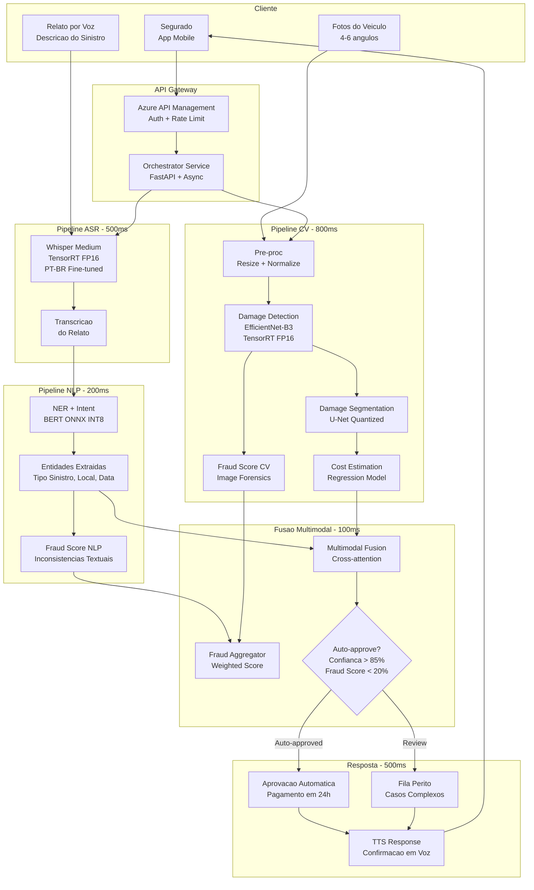

# Business Case: Assistente Virtual Multimodal

## Contexto de Negocio

Uma **empresa de seguros** brasileira com 8 milhoes de segurados busca modernizar seu processo de **vistoria e sinistro** implementando um assistente virtual multimodal. Atualmente, o processo de abertura de sinistro automotivo requer que o segurado ligue para a central, descreva o ocorrido verbalmente, envie fotos do veiculo por e-mail e aguarde 5-7 dias uteis para avaliacao de um perito humano.

O mercado global de seguros com IA esta projetado para US$ 35.8 bilhoes ate 2030 (Allied Market Research). Empresas como Lemonade, Tractable e Root ja utilizam IA multimodal para processar sinistros em minutos. A empresa precisa reduzir o tempo de processamento e melhorar a experiencia do cliente para manter competitividade no mercado brasileiro.

## Problema

| KPI | Situacao Atual | Impacto |
|-----|---------------|---------|
| Tempo medio de abertura de sinistro | 25 minutos (telefone) | Alta fricao, insatisfacao do cliente |
| Tempo de avaliacao do sinistro | 5-7 dias uteis (perito) | Cliente sem carro, insatisfeito |
| Custo por vistoria | R$ 180 (perito + deslocamento) | R$ 72M/ano (400k sinistros) |
| NPS do processo de sinistro | 28 | Muito abaixo do benchmark (50) |
| Taxa de fraude nao detectada | 8% | R$ 96M/ano em pagamentos indevidos |
| Capacidade de processamento | 800 sinistros/dia (peritos) | Gargalo em periodos de alta demanda |

**Dor principal:** O processo inteiro depende de interacao humana em multiplas etapas, resultando em **alto custo (R$ 168M/ano combinado)**, experiencia ruim para o cliente (NPS 28) e vulnerabilidade a fraude. O maior gargalo e o tempo de avaliacao do perito (5-7 dias).

## Solucao com ML

Assistente virtual multimodal que combina 4 modelos de IA para processar sinistros de forma autonoma:

1. **ASR (Speech-to-Text):** Transcreve relato verbal do segurado (Whisper)
2. **NLP (Interpretacao):** Extrai entidades e classifica tipo de sinistro (BERT fine-tuned)
3. **CV (Analise de Imagem):** Avalia danos no veiculo a partir de fotos (EfficientNet + detector de danos)
4. **TTS (Text-to-Speech):** Gera resposta em voz com status e proximo passos

### Arquitetura da Solucao

### Budget de Latencia E2E

| Componente | Latencia P95 | Execucao |
|-----------|-------------|----------|
| ASR (Whisper) | 500ms | Paralelo com CV |
| NLP (BERT NER + Intent) | 200ms | Sequencial apos ASR |
| CV (Detection + Segmentation + Estimation) | 800ms | Paralelo com ASR |
| Fraud Analysis (NLP + CV) | 100ms | Apos NLP e CV |
| Multimodal Fusion | 100ms | Apos todos os modelos |
| TTS (Resposta) | 500ms | Final |
| **Total E2E** | **< 2.5s** | **Pipeline paralelo** |

> OBS: ASR e CV executam em paralelo, reduzindo latencia total. O caminho critico e: max(ASR+NLP, CV) + Fusion + TTS = max(700ms, 800ms) + 100ms + 500ms = 1.4s. Com overheads de rede e orquestracao, o total fica < 2.5s.

## ROI Esperado

| Beneficio | Valor Estimado (Anual) |
|-----------|----------------------|
| Reducao de custo de peritos (70% auto-approved) | R$ 50.4M |
| Reducao de tempo de processamento (7d → 2min auto) | Valor intangivel (NPS) |
| Deteccao de fraude aprimorada (8% → 3%) | R$ 60.0M |
| Aumento de capacidade (800 → 10.000+ sinistros/dia) | R$ 8.0M (vendas nao perdidas) |
| **Total de beneficios** | **R$ 118.4M** |

| Custo | Valor Estimado (Anual) |
|-------|----------------------|
| Infraestrutura Azure (AKS GPU + serving) | R$ 6.0M |
| Equipe ML (6 eng + 3 data scientists + 2 MLOps) | R$ 8.8M |
| Dados de treinamento (labeling) | R$ 1.2M |
| Licencas e ferramentas | R$ 1.0M |
| **Total de custos** | **R$ 17.0M** |

| **ROI** | **597%** |
|---------|---------|
| **Payback** | **~1.7 meses** |

## Metricas de Sucesso

| Metrica | Baseline (Atual) | Meta (6 meses) | Meta (12 meses) |
|---------|------------------|-----------------|------------------|
| Latencia E2E (interacao completa) | 25 min (manual) | < 3s (auto) | < 2.5s (auto) |
| Taxa de auto-aprovacao | 0% (tudo manual) | 50% | 70% |
| Tempo de resolucao do sinistro | 5-7 dias | 24h (auto) / 3d (review) | 12h / 2d |
| Acuracia de classificacao de dano | N/A | > 90% | > 95% |
| Fraud detection rate | 92% | 95% | 97% |
| NPS do processo de sinistro | 28 | 45 | 55 |
| Custo por sinistro processado | R$ 180 | R$ 65 | R$ 45 |
| Disponibilidade do servico | N/A | 99.5% | 99.9% |

## Riscos e Mitigacoes

| Risco | Probabilidade | Impacto | Mitigacao |
|-------|---------------|---------|-----------|
| Modelo CV falha em danos sutis ou novos tipos | Media | Alto | Retraining continuo; fallback para perito humano |
| ASR com erro em sotaques regionais do Brasil | Media | Medio | Fine-tune com dataset multi-regional; fallback texto |
| False negatives em deteccao de fraude | Media | Alto | Threshold conservador; review humano para scores intermediarios |
| Latencia pipeline excede 3s em pico | Baixa | Medio | Auto-scaling por componente; models fallback mais leves |
| Regulatorio (SUSEP) nao aceita decisao automatizada | Media | Alto | Human-in-the-loop para todos os casos ate aprovacao regulatoria |
| Failure de um modelo derruba pipeline inteiro | Baixa | Alto | Circuit breakers; graceful degradation por componente |

## Tecnologias

| Camada | Tecnologia |
|--------|-----------|
| ASR | Whisper Medium + TensorRT FP16 (PT-BR fine-tuned) |
| NLP | BERT-base (PT-BR) NER + Intent, ONNX Runtime INT8 |
| CV Detection | EfficientNet-B3 + TensorRT FP16 |
| CV Segmentation | U-Net Quantized INT8 |
| Fraud | Ensemble (XGBoost + image forensics CNN) |
| TTS | VITS/FastSpeech2 (PT-BR) |
| Orchestration | FastAPI (async) + event-driven (Kafka) |
| Serving | Triton Inference Server (per-model) |
| Infra | Azure AKS (GPU T4/A100) + KServe + KEDA |
| Monitoring | Prometheus + Grafana (SLI/SLO por componente) |
| Storage | Azure Data Lake Gen2 + Azure Blob |
| ML Ops | MLflow (experiment tracking + model registry) |

## Implementacao

| Componente | Aula Relacionada |
|-----------|-----------------|
| Fine-tuning eficiente dos modelos (LoRA/QLoRA) | [Aula 5 — Transfer Learning Eficiente](../../05_transfer_learning_eficiente/) |
| Inferencia distribuida do pipeline multimodal | [Aula 7 — Inferencia Distribuida](../../07_inferencia_distribuida_paralelismo/) |
| Orquestracao multimodal em producao | [Aula 8 — Escalabilidade e Orquestracao](../../08_escalabilidade_orquestracao_multimodal/) |
| Otimizacao (quantizacao, TensorRT) | [Aula 4 — Pruning e Quantizacao](../../04_otimizacao_modelos_pruning_quantizacao/) |
| Aceleracao com GPU | [Aula 6 — Aceleracao com Hardware](../../06_aceleracao_hardware_gpu_tpu/) |
| Pipeline NLP + Audio | [Aula 2 — Desafios de Performance em NLP e Audio](../../02_desafios_performance_nlp_audio/) |

## Referencias

- Allied Market Research (2023). *AI in Insurance Market — Global Forecast 2023-2030*.
- Tractable (2024). *AI Visual Intelligence for Insurance Claims*.
- Lemonade (2023). *AI Claims Processing — Investor Report*.
- [Azure Cognitive Services — Speech + Vision](https://learn.microsoft.com/en-us/azure/cognitive-services/)
- [KServe — Multi-Model Serving](https://kserve.github.io/website/)
- SUSEP (2024). *Regulamentacao de IA em Seguros — Consulta Publica*.
