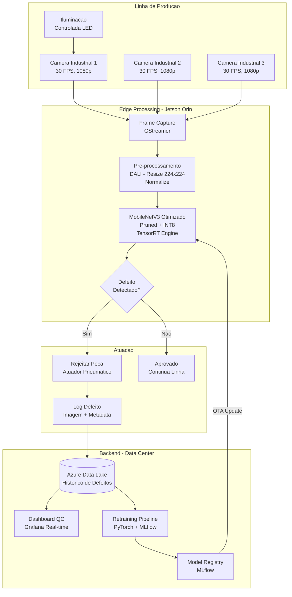
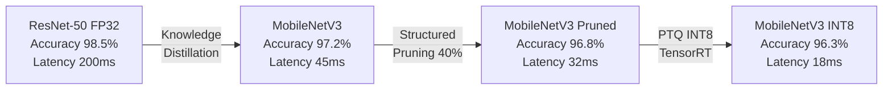

# Business Case: Inspecao Visual em Linha de Producao

## Contexto de Negocio

Uma **montadora de eletronicos** no Brasil com faturamento anual de R$ 800M opera 4 linhas de producao que fabricam smartphones e tablets. A empresa produz **~30 itens por segundo** por linha e atualmente utiliza inspecao visual manual (operadores humanos) para detectar defeitos cosmeticos e funcionais nas placas de circuito e acabamento externo dos dispositivos.

O setor de manufatura avancada esta adotando rapidamente **vision-based Quality Inspection (QI)** com deep learning, com 67% das fabricas Fortune 500 ja utilizando alguma forma de inspecao visual automatizada (McKinsey, 2024). A empresa ja tem um prototipo funcional com ResNet-50 que atingiu alta acuracia, mas cuja **latencia impede uso em tempo real** na velocidade da linha de producao.

## Problema

| KPI | Situacao Atual | Impacto |
|-----|---------------|---------|
| Latencia de inspecao | ~200ms/imagem (ResNet-50 FP32, GPU) | Insuficiente para 30 itens/s (requer < 33ms) |
| Taxa de defeitos nao detectados | 3.2% (inspecao manual) | R$ 25.6M/ano em recalls e garantia |
| Custo de inspecao manual | R$ 8.4M/ano (120 operadores, 3 turnos) | Custo fixo alto e sujeito a fadiga |
| Falsos positivos (manual) | 12% | Desperdicio de pecas boas |
| Throughput de inspecao | 8 itens/s (manual) | Gargalo na linha — limita producao |

**Dor principal:** O modelo ResNet-50 FP32 possui excelente acuracia (98.5%) mas sua **latencia de 200ms/imagem** e 6x superior ao necessario para acompanhar a velocidade da linha de producao (33ms/item). O hardware industrial disponivel no chao de fabrica (NVIDIA Jetson Orin) nao tem o poder computacional das GPUs de datacenter usadas no prototipo.

## Solucao com ML

Pipeline de otimizacao em 3 fases para reduzir latencia de 200ms para < 30ms mantendo acuracia > 96%:

1. **Fase 1 — Knowledge Distillation:** ResNet-50 (teacher) → MobileNetV3 (student) — reducao de modelo
2. **Fase 2 — Pruning estruturado:** Remocao de 40% dos filtros com menor magnitude
3. **Fase 3 — Quantizacao INT8:** Post-Training Quantization para hardware edge (Jetson Orin TensorRT)

### Arquitetura da Solucao

### Jornada de Otimizacao

## ROI Esperado

| Beneficio | Valor Estimado (Anual) |
|-----------|----------------------|
| Reducao de defeitos nao detectados (3.2% → 0.8%) | R$ 19.2M |
| Eliminacao de inspecao manual (120 operadores) | R$ 8.4M |
| Reducao de falsos positivos (12% → 3%) | R$ 2.8M |
| Aumento de throughput de producao (+12%) | R$ 5.6M |
| **Total de beneficios** | **R$ 36.0M** |

| Custo | Valor Estimado (Anual) |
|-------|----------------------|
| Hardware (12x NVIDIA Jetson Orin + cameras) | R$ 1.2M (CAPEX, ano 1) |
| Infraestrutura Azure (backend + retraining) | R$ 0.6M |
| Equipe ML (2 eng + 1 MLOps) | R$ 1.8M |
| Manutencao e calibracao | R$ 0.4M |
| **Total de custos** | **R$ 4.0M** |

| **ROI** | **800%** |
|---------|---------|
| **Payback** | **~1.3 meses** |

## Metricas de Sucesso

| Metrica | Baseline (ResNet-50 FP32) | Meta (Optimized INT8) |
|---------|---------------------------|------------------------|
| Latencia por imagem | 200ms | < 30ms |
| Throughput | 5 items/s | > 33 items/s |
| Acuracia (defeito detection) | 98.5% | > 96% |
| Falso positivo rate | 4% | < 2% |
| Tamanho do modelo | 97 MB | < 12 MB |
| Consumo de energia | 250W (GPU datacenter) | 30W (Jetson Orin) |
| Disponibilidade | N/A | > 99.5% |

## Riscos e Mitigacoes

| Risco | Probabilidade | Impacto | Mitigacao |
|-------|---------------|---------|-----------|
| Queda de acuracia > 3% apos otimizacao | Media | Alto | QAT se PTQ nao atingir meta; calibracao com dados de producao |
| Novos tipos de defeito nao reconhecidos | Media | Medio | Retraining continuo com dados novos; alerta de low confidence |
| Variacao de iluminacao na fabrica | Baixa | Medio | Iluminacao controlada; augmentation robusto no treinamento |
| Falha de hardware edge | Baixa | Alto | Redundancia (2 Jetson por linha); fallback para inspecao manual |
| Drift de dados (mudanca de componentes) | Media | Medio | Monitoramento de PSI; trigger automatico de retraining |

## Tecnologias

| Camada | Tecnologia |
|--------|-----------|
| Modelo original | ResNet-50 (PyTorch) |
| Modelo otimizado | MobileNetV3 (pruned + INT8) |
| Distillation | PyTorch (teacher-student framework) |
| Pruning | torch.nn.utils.prune (structured, L1) |
| Quantizacao | TensorRT PTQ INT8 (calibracao com 1000 imagens) |
| Pre-processamento | NVIDIA DALI (GPU-accelerated) |
| Hardware edge | NVIDIA Jetson Orin (TensorRT runtime) |
| Backend | Azure Data Lake + MLflow + Grafana |
| OTA Updates | Azure IoT Hub |

## Implementacao

| Componente | Aula Relacionada |
|-----------|-----------------|
| Arquiteturas eficientes (MobileNetV3) | [Aula 3 — Desafios de Performance em Visao Computacional](../../03_desafios_performance_visao_computacional/) |
| Pruning + Quantizacao + Distillation | [Aula 4 — Otimizacao de Modelos](../../04_otimizacao_modelos_pruning_quantizacao/) |
| NVIDIA Jetson + TensorRT | [Aula 6 — Aceleracao com Hardware](../../06_aceleracao_hardware_gpu_tpu/) |
| Profiling e benchmarking | [Aula 1 — Fundamentos de Latencia](../../01_fundamentos_latencia_performance_ml/) |

## Referencias

- McKinsey (2024). *AI-Powered Quality Inspection in Manufacturing.*
- Frankle, J. & Carlin, M. (2019). *The Lottery Ticket Hypothesis*. ICLR.
- Howard, A. et al. (2019). *Searching for MobileNetV3*. ICCV.
- [NVIDIA Jetson Orin — Developer Guide](https://developer.nvidia.com/embedded/jetson-orin)
- [TensorRT INT8 Quantization Guide](https://docs.nvidia.com/deeplearning/tensorrt/developer-guide/)
- Bosch AI (2023). *Visual Inspection with Deep Learning in Automotive Manufacturing*.
