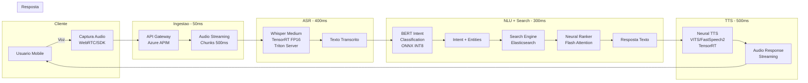

# Business Case: Assistente de Voz para E-commerce

## Contexto de Negocio

Uma grande plataforma de e-commerce brasileira com **15 milhoes de usuarios ativos mensais** busca diferenciar-se da concorrencia implementando um **assistente de voz inteligente** que permite aos clientes pesquisar produtos, tirar duvidas e completar compras utilizando interacao por voz natural. O canal de voz e especialmente estrategico para usuarios mobile (68% do trafego) e para acessibilidade.

O mercado de voice commerce deve atingir US$ 80 bilhoes globalmente ate 2027 (Juniper Research). Empresas como Amazon (Alexa), Google (Assistant) e Mercado Livre ja investem em interfaces de voz para e-commerce. A empresa precisa implementar esta capacidade para manter competitividade.

## Problema

| KPI | Situacao Atual | Impacto |
|-----|---------------|---------|
| Taxa de conversao mobile | 2.1% | Abaixo da media do setor (3.5%) |
| Tempo medio de busca | 45 segundos (digitacao) | Usuarios mobile abandonam busca complexa |
| Taxa de abandono de busca | 35% | Produtos nao encontrados = vendas perdidas |
| NPS de UX mobile | 42 | Abaixo do benchmark (55) |
| Acessibilidade | Nao atende WCAG 2.1 AA | Risco regulatorio e exclusao de usuarios |

**Dor principal:** Usuarios mobile gastam tempo excessivo digitando em telas pequenas para buscar produtos. Buscas complexas ("vestido vermelho para festa de casamento tamanho M") sao abandonadas frequentemente, resultando em **perda estimada de R$ 2.3M/mes** em vendas nao convertidas.

## Solucao com ML

Pipeline de voz end-to-end com 4 etapas, cada uma otimizada para latencia:

1. **ASR (Automatic Speech Recognition):** Whisper medium otimizado com TensorRT FP16
2. **NLU (Natural Language Understanding):** BERT fine-tuned para intent classification + entity extraction
3. **Search/Response Generation:** Modelo de ranking + resposta com Flash Attention
4. **TTS (Text-to-Speech):** Modelo neural TTS com vocoder otimizado

### Arquitetura da Solucao

### Budget de Latencia

| Componente | Latencia P95 Alvo | Tecnica de Otimizacao |
|-----------|-------------------|----------------------|
| Audio Streaming | 50ms | Chunks de 500ms via WebRTC |
| ASR (Whisper) | 400ms | TensorRT FP16, batch size 1 |
| NLU (BERT) | 50ms | ONNX Runtime INT8 |
| Search + Ranking | 250ms | Flash Attention, cache de embeddings |
| TTS | 500ms | Streaming synthesis, vocoder otimizado |
| Network overhead | 150ms | CDN, connection pooling |
| **Total E2E** | **< 1.4s** | **Meta SLO: 95% < 2s** |

## ROI Esperado

| Beneficio | Valor Estimado (Anual) |
|-----------|----------------------|
| Aumento de conversao mobile (+1.4pp) | R$ 27.6M |
| Reducao de abandono de busca (-15pp) | R$ 16.8M |
| Compliance WCAG 2.1 (evitar multas) | R$ 2.0M |
| Reducao custo de suporte (menos tickets) | R$ 3.2M |
| **Total de beneficios** | **R$ 49.6M** |

| Custo | Valor Estimado (Anual) |
|-------|----------------------|
| Infraestrutura Azure (GPU serving) | R$ 4.8M |
| Equipe de ML (4 eng + 2 data scientists) | R$ 3.6M |
| Licencas e ferramentas | R$ 0.8M |
| **Total de custos** | **R$ 9.2M** |

| **ROI** | **439%** |
|---------|---------|
| **Payback** | **~2.2 meses** |

## Metricas de Sucesso

| Metrica | Baseline (Atual) | Meta (6 meses) | Meta (12 meses) |
|---------|------------------|-----------------|------------------|
| Latencia E2E P95 | N/A (novo canal) | < 2.0s | < 1.5s |
| Taxa de conversao mobile | 2.1% | 3.0% | 3.5% |
| Taxa de abandono de busca | 35% | 25% | 20% |
| Word Error Rate (ASR) | N/A | < 12% | < 8% |
| Intent Accuracy (NLU) | N/A | > 90% | > 95% |
| NPS de UX mobile | 42 | 50 | 58 |
| Disponibilidade | N/A | 99.5% | 99.9% |

## Riscos e Mitigacoes

| Risco | Probabilidade | Impacto | Mitigacao |
|-------|---------------|---------|-----------|
| ASR com alta taxa de erro em portugues brasileiro | Media | Alto | Fine-tune Whisper com dataset PT-BR; fallback para digitacao |
| Latencia excede SLO de 2s em pico | Media | Alto | Auto-scaling com KEDA; cache agressivo; modelo fallback mais leve |
| Custo de GPU superior ao projetado | Baixa | Medio | Quantizacao INT8 para reduzir GPU necessaria; spot instances |
| Usuarios nao adotam canal de voz | Media | Alto | A/B testing gradual; UI que incentiva uso; metricas de engajamento |
| Privacidade de dados de voz | Baixa | Alto | Processamento server-side (sem armazenamento de audio); compliance LGPD |

## Tecnologias

| Camada | Tecnologia |
|--------|-----------|
| ASR | Whisper Medium + TensorRT FP16 |
| NLU | BERT-base (PT-BR) + ONNX Runtime INT8 |
| Search | Elasticsearch + Neural Ranker (Flash Attention) |
| TTS | VITS/FastSpeech2 + TensorRT |
| API | FastAPI + gRPC (inter-service) |
| Serving | Triton Inference Server (dynamic batching) |
| Infra | Azure AKS (GPU T4 node pool) + KEDA autoscaling |
| Monitoring | Prometheus + Grafana (SLI/SLO dashboards) |
| Cache | Azure Cache for Redis |

## Implementacao

Este business case integra conteudo de multiplas aulas:

| Componente | Aula Relacionada |
|-----------|-----------------|
| Pipeline ASR + NLP + TTS | [Aula 2 — Desafios de Performance em NLP e Audio](../../02_desafios_performance_nlp_audio/) |
| Auto-scaling e serving distribuido | [Aula 7 — Inferencia Distribuida e Paralelismo](../../07_inferencia_distribuida_paralelismo/) |
| Orquestracao multimodal em producao | [Aula 8 — Escalabilidade e Orquestracao Multimodal](../../08_escalabilidade_orquestracao_multimodal/) |
| Otimizacao TensorRT e quantizacao | [Aula 4 — Pruning e Quantizacao](../../04_otimizacao_modelos_pruning_quantizacao/) |

## Referencias

- Juniper Research (2023). *Voice Commerce Market Forecast 2023-2027*.
- Radford, A. et al. (2023). *Robust Speech Recognition via Large-Scale Weak Supervision* (Whisper). OpenAI.
- Dao, T. et al. (2022). *FlashAttention: Fast and Memory-Efficient Exact Attention with IO-Awareness*. NeurIPS.
- Amazon (2023). *Alexa Voice Commerce Insights Report*.
- [NVIDIA Triton Inference Server — Dynamic Batching](https://docs.nvidia.com/deeplearning/triton-inference-server/)
