# Processo End-to-End de ML em Producao

## Visao Geral

Diagrama BPMN-style representando o processo completo de desenvolvimento e operacao de modelos de ML para dados nao estruturados, desde a requisicao de negocio ate o monitoramento continuo em producao, com enfase nos pontos de decisao relacionados a latencia e performance.

## Processo de ML — Da Requisicao ao Monitoramento

```mermaid
graph TD
    Start([Requisicao<br/>de Negocio]) --> Define[Definir Problema<br/>Metricas de Sucesso<br/>SLOs de Latencia]
    Define --> Collect[Coletar Dados<br/>Nao Estruturados<br/>Imagem/Audio/Texto]
    Collect --> EDA[Analise Exploratoria<br/>Distribuicoes<br/>Qualidade dos Dados]
    EDA --> Clean[Limpeza e<br/>Transformacao<br/>Normalizacao]
    Clean --> Feature[Feature Engineering<br/>Embeddings<br/>Augmentation]
    Feature --> Split[Train/Val/Test<br/>Split Estratificado]
    Split --> Baseline[Treinar Baseline<br/>Modelo Simples<br/>Medir Latencia P95]

    Baseline --> EvalBase{Baseline<br/>Aceitavel?}
    EvalBase -->|Nao| Revisit[Revisar Dados<br/>e Features]
    Revisit --> Clean
    EvalBase -->|Sim| Train[Treinar Modelo<br/>Avancado<br/>CNN/Transformer/LLM]

    Train --> Eval{Metricas de<br/>Acuracia OK?}
    Eval -->|Nao| Tune[Ajustar<br/>Hiperparametros<br/>PEFT/LoRA]
    Tune --> Train
    Eval -->|Sim| Profile[Profiling<br/>de Latencia<br/>P50/P95/P99]

    Profile --> LatencyOK{Latencia<br/>dentro do SLO?}
    LatencyOK -->|Nao| Optimize[Otimizar Modelo]

    subgraph "Pipeline de Otimizacao"
        Optimize --> Prune[Pruning<br/>Estruturado]
        Prune --> Quant[Quantizacao<br/>PTQ INT8/QAT]
        Quant --> Distill[Knowledge<br/>Distillation]
        Distill --> Export[Exportar<br/>ONNX/TensorRT]
    end

    Export --> ReEval{Acuracia<br/>pos-otimizacao<br/>aceitavel?}
    ReEval -->|Nao| Tune
    ReEval -->|Sim| LatencyOK
    LatencyOK -->|Sim| Register[Registrar Modelo<br/>MLflow Registry]

    Register --> Deploy[Deploy em<br/>Staging<br/>AKS/KServe]
    Deploy --> IntegTest[Testes de<br/>Integracao<br/>Load Test]
    IntegTest --> SLOTest{SLO de<br/>Latencia OK<br/>sob Carga?}
    SLOTest -->|Nao| Scale[Ajustar<br/>Scaling/Batching<br/>Hardware]
    Scale --> Deploy
    SLOTest -->|Sim| Canary[Canary<br/>Deploy 5%]

    Canary --> CanaryOK{Metricas<br/>Canary OK?}
    CanaryOK -->|Nao| Rollback[Rollback<br/>Versao Anterior]
    Rollback --> Tune
    CanaryOK -->|Sim| FullDeploy[Full Rollout<br/>100% Traffic]

    FullDeploy --> Monitor[Monitorar<br/>Latencia + Acuracia<br/>SLIs/SLOs]
    Monitor --> Drift{Data/Model<br/>Drift Detectado?}
    Drift -->|Sim| Retrain[Trigger<br/>Retraining<br/>com Novos Dados]
    Retrain --> Train
    Drift -->|Nao| SLOBreach{SLO de<br/>Latencia<br/>Violado?}
    SLOBreach -->|Sim| Investigate[Investigar<br/>Causa Raiz<br/>Profiling]
    Investigate --> Optimize
    SLOBreach -->|Nao| Monitor
```

## Fases e Responsabilidades

| Fase | Responsavel | Ferramentas | Entrega |
|------|------------|-------------|---------|
| Requisicao de Negocio | Product Owner | Jira, Confluence | Documento de requisitos + SLOs |
| Coleta e EDA | Data Engineer | Pandas, DVC, Azure Data Lake | Dataset versionado |
| Treinamento | ML Engineer | PyTorch, TF, MLflow | Modelo treinado + metricas |
| Otimizacao | ML Engineer | TensorRT, ONNX, torch.compile | Modelo otimizado com benchmark |
| Deploy | MLOps Engineer | KServe, AKS, Triton | Modelo em producao |
| Monitoramento | SRE / MLOps | Prometheus, Grafana | Dashboards de SLI/SLO |
| Retraining | ML Engineer | Pipeline automatizado | Modelo atualizado |
