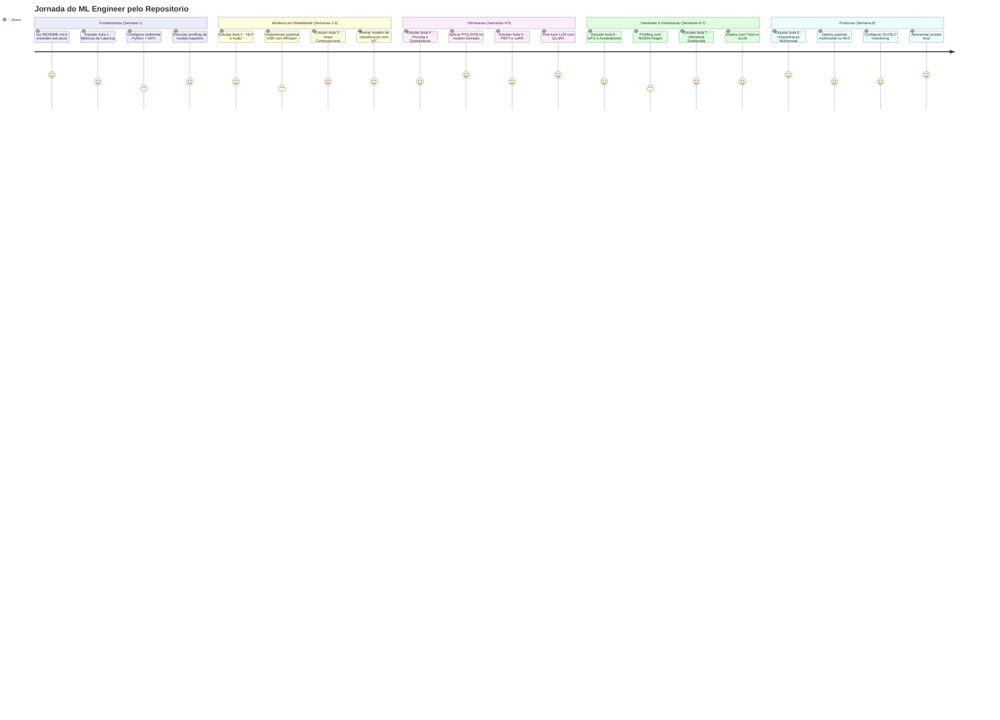
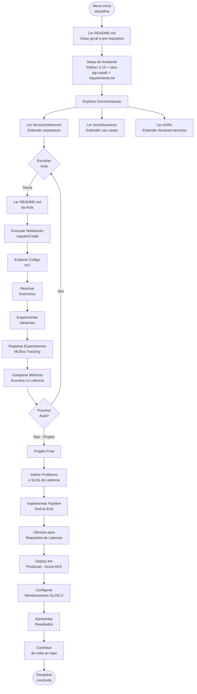

# Jornada do Usuario — Cientista de Dados / ML Engineer

## Visao Geral

Diagrama da jornada do aluno/profissional utilizando este repositorio para desenvolver um projeto de ML com foco em latencia e performance, desde a escolha do problema ate o deployment em producao.

## Jornada do Usuario pelo Repositorio

## Fluxo Detalhado de Uso do Repositorio

## Checkpoints de Aprendizado

| Semana | Checkpoint | Evidencia |
|--------|-----------|-----------|
| 1 | Entende metricas de latencia P50/P95/P99 | Profiling executado e interpretado |
| 2 | Implementou pipeline NLP ou Audio | Notebook funcional com benchmark |
| 3 | Treinou modelo de visao computacional | Metricas de acuracia e latencia registradas |
| 4 | Aplicou pruning + quantizacao | Comparacao antes/depois com metricas |
| 5 | Fine-tuned modelo com PEFT | LoRA adapter treinado com metricas |
| 6 | Profiling em GPU com mixed precision | Nsight report ou PyTorch Profiler trace |
| 7 | Deploy distribuido funcional | Triton ou vLLM servindo inferencia |
| 8 | Pipeline multimodal em producao | AKS deployment com SLI/SLO dashboard |
