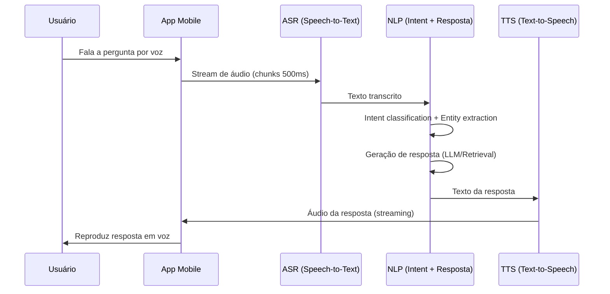
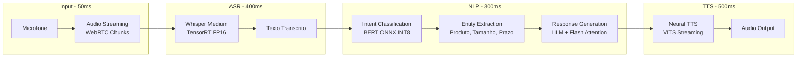

# Use Case — Aula 2: Assistente de Voz no E-commerce

## Contexto da Aula

**Aula 2 — Desafios de Performance em NLP e Áudio**

---

## Cenário

Um cliente acessa uma plataforma de e-commerce pelo celular e faz uma pergunta por voz sobre um produto — por exemplo: *"Esse tênis está disponível no tamanho 42 e qual o prazo de entrega?"*. O sistema precisa capturar a fala, converter em texto, processar a intenção, gerar uma resposta relevante e devolvê-la em voz, tudo com latência imperceptível para o usuário.

---

## Fluxo End-to-End

**Fluxo resumido:** Fala → Texto → Resposta → Fala (interação natural)

---

## Requisitos

| Requisito | Especificação |
|-----------|---------------|
| **Latência E2E** | Resposta imediata — UX com mínimo atraso perceptível |
| **Meta de SLO** | 95% das respostas < 2s (fim-a-fim, incluindo ASR + NLP + TTS) |
| **Carga estimada** | ~100 consultas/minuto em horário de pico |
| **Disponibilidade** | 99.9% — canal de vendas crítico |
| **Idioma** | Português brasileiro (PT-BR) com sotaques regionais |

---

## Budget de Latência

| Etapa | Latência Alvo (P95) | Modelo / Técnica |
|-------|---------------------|------------------|
| Captura + streaming de áudio | ~50ms | WebRTC, chunks de 500ms |
| ASR (Speech-to-Text) | < 400ms | Whisper Medium, TensorRT FP16 |
| NLP (Intent + Resposta) | < 300ms | BERT INT8 (intent) + LLM com Flash Attention |
| TTS (Text-to-Speech) | < 500ms | VITS/FastSpeech2, streaming synthesis |
| Overhead de rede | ~150ms | CDN, connection pooling |
| **Total** | **< 1.4s** | **Meta SLO: 95% < 2s** |

---

## Impacto de Negócio

- **Atraso > 3s** → usuário desiste → **perda direta de vendas**
- Estudos de UX indicam que cada 100ms adicionais de latência em voice commerce resulta em queda de ~1% na conversão
- Canal de voz é especialmente crítico para usuários mobile (68% do tráfego) e acessibilidade

---

## Desafios Técnicos Abordados na Aula

| Desafio | Conceito da Aula 2 |
|---------|---------------------|
| Complexidade quadrática da atenção no Transformer | Mecanismos de atenção eficiente: Flash Attention, Sparse Attention, Linear Attention |
| Geração autoregressiva sequencial no TTS/LLM | Gargalo da geração sequencial; modelos non-autoregressive |
| Batching de sequências de comprimento variável | Estratégias de padding vs. packing; overhead de padding |
| Tokenização e impacto na latência | BPE, SentencePiece — tamanho do vocabulário vs. velocidade |
| Processamento de áudio em tempo real | Espectrogramas Mel/MFCC; modelos Whisper e wav2vec 2.0 |

---

## Diagrama de Componentes

---

## Tecnologias Relacionadas

- **ASR:** Whisper (OpenAI), wav2vec 2.0
- **NLP:** Hugging Face Transformers, Flash Attention, ONNX Runtime
- **TTS:** VITS, FastSpeech2
- **Serving:** Triton Inference Server (dynamic batching)
- **Infra:** FastAPI, Azure AKS, Redis (cache de respostas frequentes)

---

## Conexões com Outras Aulas

| Aula | Relação |
|------|---------|
| Aula 1 | Métricas P50/P95/P99 e profiling de cada etapa do pipeline |
| Aula 4 | Quantização INT8 do modelo BERT para reduzir latência NLU |
| Aula 5 | Fine-tuning eficiente (LoRA) do LLM para domínio e-commerce |
| Aula 7 | Serving distribuído com Triton para escalar em horário de pico |
| Aula 8 | Orquestração do pipeline multimodal (ASR → NLP → TTS) em produção |

---

## Referências

- Radford, A. et al. (2023). *Robust Speech Recognition via Large-Scale Weak Supervision* (Whisper). OpenAI.
- Dao, T. et al. (2022). *FlashAttention: Fast and Memory-Efficient Exact Attention with IO-Awareness*. NeurIPS.
- Baevski, A. et al. (2020). *wav2vec 2.0: A Framework for Self-Supervised Learning of Speech Representations*. NeurIPS.
- Kim, J. et al. (2021). *Conditional Variational Autoencoder with Adversarial Learning for End-to-End Text-to-Speech* (VITS). ICML.

---

📂 **Material da aula:** [Aula 2 — Desafios de Performance em NLP e Áudio](../../02_desafios_performance_nlp_audio/)
📋 **Business Case completo:** [Assistente de Voz para E-commerce](business-case-voice-assistant-ecommerce.md)
