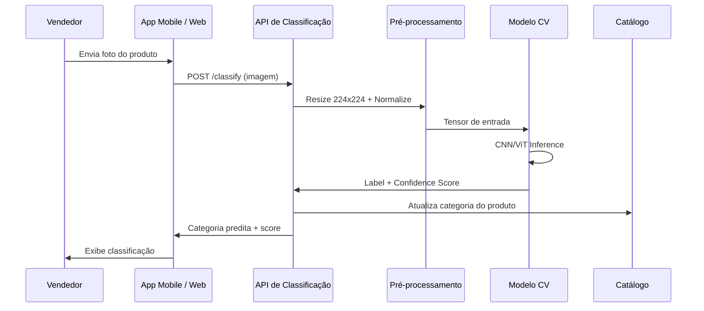
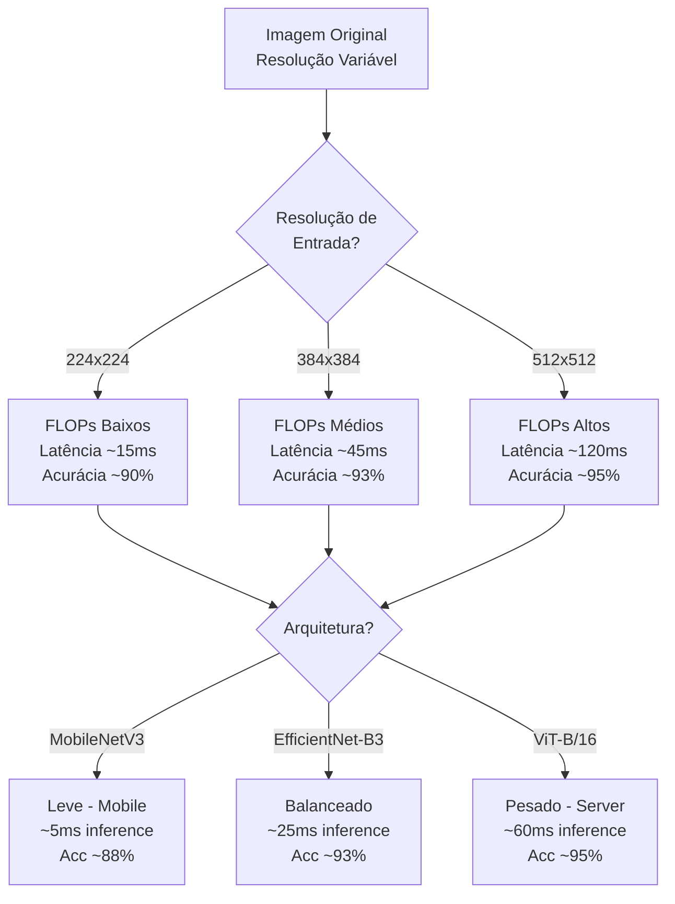
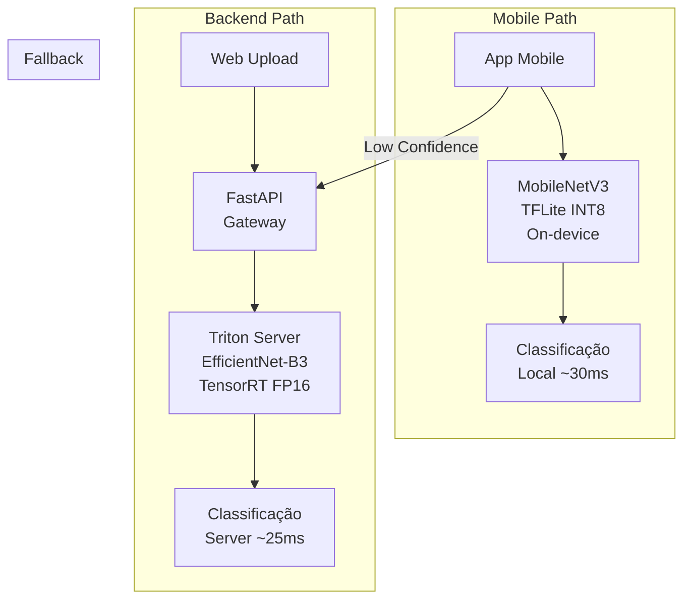

# Use Case — Aula 3: Classificação de Imagens de Produtos

## Contexto da Aula

**Aula 3 — Desafios de Performance em Visão Computacional**

---

## Cenário

Uma plataforma de marketplace recebe milhares de imagens de produtos enviadas por vendedores diariamente. O sistema precisa **classificar automaticamente cada produto** a partir de sua foto — por exemplo, distinguir uma câmera fotográfica de um smartphone, ou categorizar roupas por tipo (camiseta, calça, vestido). A classificação alimenta a busca, a navegação por categorias e o sistema de recomendação.

Além do backend, a empresa oferece um **app mobile** que permite ao vendedor fotografar o produto e obter a classificação instantaneamente, exigindo inferência rápida para uma boa experiência de uso.

---

## Fluxo End-to-End

---

## Requisitos

| Requisito | Especificação |
|-----------|---------------|
| **Tarefa** | Predição de rótulo único por imagem (single-label classification) |
| **Classes** | ~200 categorias de produto (eletrônicos, roupas, acessórios, etc.) |
| **Modelos base** | Pré-treinados em ImageNet (transfer learning) |
| **Latência (backend)** | < 100ms por imagem (P95) |
| **Latência (mobile)** | < 200ms on-device para UX responsiva |
| **Acurácia** | Top-1 > 92%, Top-5 > 98% |
| **Throughput (backend)** | > 500 classificações/segundo |

---

## Desafios de Performance

| Desafio | Impacto |
|---------|---------|
| Resolução de entrada vs. FLOPs | Dobrar resolução → ~4x mais FLOPs → ~3x mais latência |
| CNN vs. Vision Transformer (ViT) | ViT mais preciso, mas mais lento; CNN melhor para mobile |
| Inferência on-device (mobile) | Hardware limitado exige modelos compactos (MobileNet, EfficientNet-lite) |
| Variabilidade de imagens | Fotos de vendedores com iluminação ruim, fundo variado, ângulos diferentes |

---

## Comparação de Arquiteturas

| Modelo | Params | FLOPs | Latência GPU (P95) | Latência Mobile (P95) | Top-1 Acc (ImageNet) |
|--------|--------|-------|---------------------|------------------------|----------------------|
| MobileNetV3-Large | 5.4M | 219M | ~5ms | ~30ms | 75.2% |
| EfficientNet-B0 | 5.3M | 390M | ~8ms | ~45ms | 77.1% |
| EfficientNet-B3 | 12M | 1.8B | ~25ms | ~120ms | 81.6% |
| ResNet-50 | 25.6M | 4.1B | ~15ms | ~180ms | 80.4% |
| ViT-B/16 | 86.6M | 17.6B | ~60ms | N/A (muito grande) | 84.5% |
| EfficientViT-B1 | 9.1M | 520M | ~10ms | ~55ms | 79.4% |

> *Latências estimadas para resolução 224x224, GPU NVIDIA T4, mobile Snapdragon 8 Gen 2*

---

## Desafios Técnicos Abordados na Aula

| Desafio | Conceito da Aula 3 |
|---------|---------------------|
| Trade-off CNN vs. ViT en latência e acurácia | Comparação detalhada de arquiteturas com benchmarks |
| Impacto da resolução de entrada nos FLOPs | Análise quantitativa: resolução vs. FLOPs vs. latência |
| Modelos eficientes para mobile e edge | MobileNet, EfficientNet, EfficientViT |
| Detecção de objetos em tempo real | YOLO v8/v11, RT-DETR (extensão do use case para multi-objeto) |
| Pré-processamento otimizado | NVIDIA DALI, torchvision.transforms.v2 (CPU → GPU) |
| Streaming de vídeo para inferência | Keyframe extraction, temporal downsampling |

---

## Diagrama de Deployment

---

## Tecnologias Relacionadas

- **Modelos:** MobileNetV3, EfficientNet, EfficientViT, ViT, ResNet
- **Frameworks:** PyTorch (torchvision), TensorFlow/Keras
- **Otimização:** TensorRT, ONNX Runtime, TFLite
- **Pré-processamento:** NVIDIA DALI, torchvision.transforms.v2, OpenCV
- **Serving:** Triton Inference Server, FastAPI

---

## Conexões com Outras Aulas

| Aula | Relação |
|------|---------|
| Aula 1 | Profiling de FLOPs, MACs e latência P95 por modelo |
| Aula 4 | Pruning e quantização do EfficientNet para deployment mobile |
| Aula 5 | Transfer learning do ImageNet para domínio de produtos |
| Aula 6 | Tensor Cores FP16 para acelerar inferência do ViT no servidor |
| Aula 8 | Classificação como componente de pipeline multimodal |

---

## Referências

- Howard, A. et al. (2019). *Searching for MobileNetV3*. ICCV.
- Tan, M. & Le, Q. (2019). *EfficientNet: Rethinking Model Scaling for CNNs*. ICML.
- Dosovitskiy, A. et al. (2020). *An Image is Worth 16x16 Words: Transformers for Image Recognition at Scale* (ViT). ICLR.
- Liu, X. et al. (2023). *EfficientViT: Memory Efficient Vision Transformer with Cascaded Group Attention*. CVPR.
- [NVIDIA DALI Documentation](https://docs.nvidia.com/deeplearning/dali/)

---

📂 **Material da aula:** [Aula 3 — Desafios de Performance em Visão Computacional](../../03_desafios_performance_visao_computacional/)
