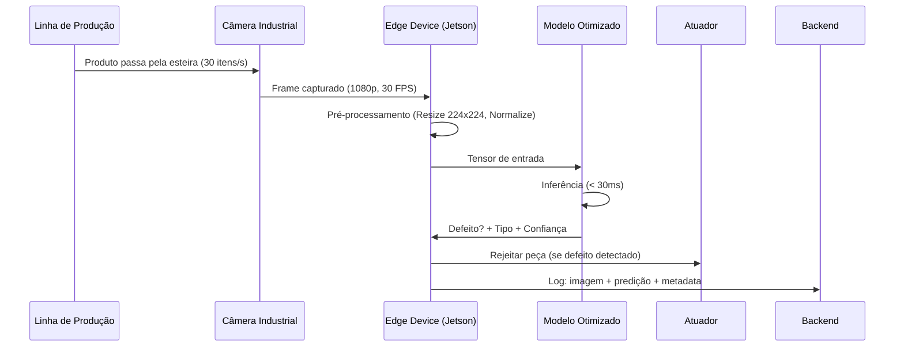
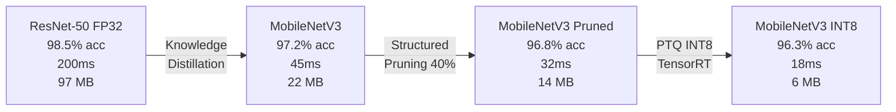
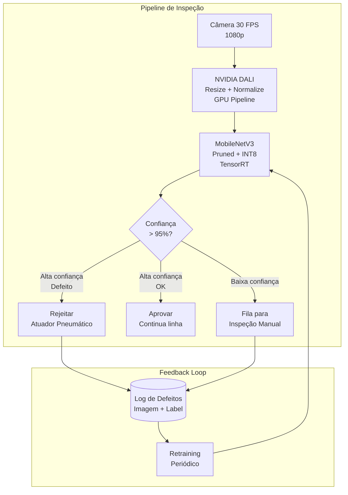

# Use Case — Aula 4: Inspeção Visual em Linha de Produção

## Contexto da Aula

**Aula 4 — Otimização de Modelos: Pruning e Quantização**

---

## Cenário

Uma fábrica de eletrônicos utiliza **deep learning** para detectar defeitos visuais em produtos na linha de produção — arranhões, soldas frias, componentes desalinhados. O modelo **ResNet-50** treinado internamente atingiu excelente acurácia (98.5%) na identificação de falhas, mas sua **latência de ~200ms por imagem** é insuficiente para acompanhar a velocidade da linha, que opera a **~30 itens por segundo**.

O hardware disponível no chão de fábrica é limitado — dispositivos industriais embarcados (NVIDIA Jetson) sem as GPUs de datacenter usadas no desenvolvimento. A empresa precisa de uma solução **mais leve** que mantenha acurácia aceitável (> 96%) com latência inferior a 33ms por imagem.

---

## Fluxo End-to-End

---

## O Problema

| Métrica | Modelo Atual (ResNet-50 FP32) | Meta Necessária |
|---------|-------------------------------|-----------------|
| **Latência** | ~200ms/imagem | < 33ms/imagem |
| **Throughput** | ~5 itens/s | ≥ 30 itens/s |
| **Acurácia** | 98.5% | ≥ 96% |
| **Tamanho do modelo** | 97 MB | < 15 MB (edge) |
| **Hardware** | GPU datacenter (V100) | NVIDIA Jetson Orin (edge) |
| **Consumo** | 250W | < 30W |

**Gap:** Redução de **6x em latência** necessária, com perda máxima de **2.5pp de acurácia**.

---

## Jornada de Otimização

| Etapa | Técnica | Acurácia | Latência | Tamanho | Speedup Acumulado |
|-------|---------|----------|----------|---------|-------------------|
| Baseline | ResNet-50 FP32 | 98.5% | 200ms | 97 MB | 1.0x |
| Distillation | Teacher → Student | 97.2% | 45ms | 22 MB | 4.4x |
| Pruning | Estruturado L1 (40% filtros) | 96.8% | 32ms | 14 MB | 6.3x |
| Quantização | PTQ INT8 (TensorRT) | 96.3% | 18ms | 6 MB | **11.1x** |

---

## Desafios Técnicos Abordados na Aula

| Desafio | Conceito da Aula 4 |
|---------|---------------------|
| Modelo muito pesado para hardware edge | Hipótese da Lottery Ticket — redes over-parametrizadas contêm sub-redes eficientes |
| Redução de latência sem perda de acurácia | Pruning estruturado vs. não-estruturado: critérios de importância (L1, Taylor) |
| Compressão de modelo para INT8 | Quantização pós-treinamento (PTQ): calibração com dados representativos |
| Recuperar acurácia após quantização agressiva | Quantização consciente de treinamento (QAT) — simula quantização durante treino |
| Criar modelo menor com acurácia do grande | Knowledge Distillation: teacher-student framework |
| Maximizar ganho com múltiplas técnicas | Combinação sinérgica: pruning + quantização + distillation |
| Impacto quantitativo em acurácia vs. latência | Benchmark sistemático a cada etapa de otimização |

---

## Diagrama de Detecção

---

## Tecnologias Relacionadas

- **Modelo original:** ResNet-50 (PyTorch)
- **Modelo otimizado:** MobileNetV3 (pruned + INT8)
- **Pruning:** `torch.nn.utils.prune` (structured, critério L1)
- **Quantização:** TensorRT PTQ INT8, `torch.quantization` QAT
- **Distillation:** PyTorch teacher-student framework
- **Pré-processamento:** NVIDIA DALI (GPU-accelerated)
- **Hardware edge:** NVIDIA Jetson Orin (TensorRT runtime)

---

## Conexões com Outras Aulas

| Aula | Relação |
|------|---------|
| Aula 1 | Profiling de latência e FLOPs: baseline vs. modelo otimizado |
| Aula 3 | Arquiteturas eficientes (MobileNet) e pré-processamento com DALI |
| Aula 5 | Exportação do modelo otimizado (ONNX, TorchScript) |
| Aula 6 | Deploy no NVIDIA Jetson com TensorRT e Tensor Cores INT8 |
| Aula 8 | Monitoramento de SLI/SLO em produção industrial |

---

## Referências

- Frankle, J. & Carlin, M. (2019). *The Lottery Ticket Hypothesis: Finding Sparse, Trainable Neural Networks*. ICLR.
- Hinton, G., Vinyals, O. & Dean, J. (2015). *Distilling the Knowledge in a Neural Network*. NeurIPS Workshop.
- Jacob, B. et al. (2018). *Quantization and Training of Neural Networks for Efficient Integer-Arithmetic-Only Inference*. CVPR.
- [TensorRT INT8 Quantization Guide](https://docs.nvidia.com/deeplearning/tensorrt/developer-guide/)
- [PyTorch Pruning Tutorial](https://pytorch.org/tutorials/intermediate/pruning_tutorial.html)

---

📂 **Material da aula:** [Aula 4 — Otimização de Modelos: Pruning e Quantização](../../04_otimizacao_modelos_pruning_quantizacao/)
📋 **Business Case completo:** [Inspeção Visual em Linha de Produção](business-case-visual-inspection.md)
