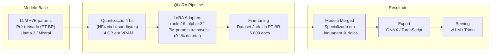
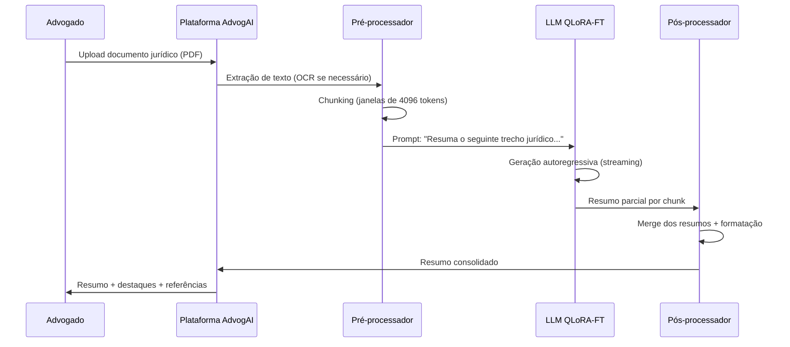
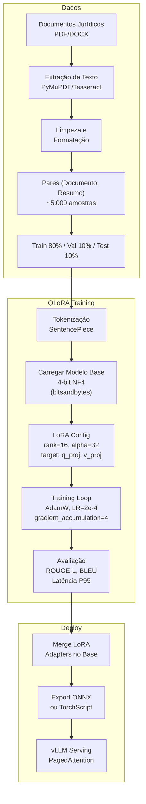

# Use Case — Aula 5: AdvogAI — Resumir Documentos Jurídicos com IA

## Contexto da Aula

**Aula 5 — Transfer Learning Eficiente e Adaptação de Modelos**

---

## Cenário

A startup **AdvogAI** desenvolve uma solução de IA para escritórios de advocacia que automatiza o resumo de documentos jurídicos — petições, contratos, sentenças e pareceres. O objetivo é reduzir o tempo que advogados gastam lendo documentos extensos (frequentemente > 50 páginas) de horas para minutos, gerando resumos precisos que preservam os pontos jurídicos relevantes.

A equipe possui um único servidor com **1 GPU** (NVIDIA A100 40GB) e precisa adaptar um **LLM de ~7 bilhões de parâmetros** para a linguagem jurídica em português. O fine-tuning completo é **inviável** — exigiria múltiplas GPUs A100 e semanas de treinamento, com custo proibitivo para uma startup em estágio inicial.

---

## O Problema

| Aspecto | Fine-tuning Completo | Restrição da AdvogAI |
|---------|----------------------|----------------------|
| **Parâmetros treináveis** | ~7B (100%) | Inviável — OOM em 1 GPU |
| **Memória GPU requerida** | ~112 GB (FP16) + gradientes | 40 GB disponíveis |
| **Tempo de treinamento** | 2-3 semanas (4x A100) | Poucos dias com 1 GPU |
| **Custo estimado** | > US$ 10.000 por run | Budget < US$ 1.000 |
| **Risco de overfitting** | Alto (dataset jurídico é pequeno) | Dataset: ~5.000 documentos |

---

## Solução: Fine-Tuning Eficiente com LoRA + QLoRA

---

## Fluxo de Uso

---

## Comparação de Abordagens

| Abordagem | Params Treináveis | Memória GPU | Tempo (1 GPU) | Acurácia (ROUGE-L) | Custo |
|-----------|-------------------|-------------|---------------|---------------------|-------|
| Fine-tuning Completo (FP16) | 7B (100%) | ~112 GB | Inviável (OOM) | Baseline: 0.72 | > $10k |
| Fine-tuning Completo (FP32) | 7B (100%) | ~224 GB | Inviável | 0.72 | > $20k |
| **LoRA (FP16)** | ~7M (0.1%) | ~28 GB | 3-4 dias | 0.70 | ~$600 |
| **QLoRA (4-bit + FP16 adapters)** | ~7M (0.1%) | **~8 GB** | **2-3 dias** | **0.69** | **~$300** |
| Prompt Tuning | ~100K (0.001%) | ~14 GB | 1 dia | 0.62 | ~$100 |
| Prefix Tuning | ~500K (0.007%) | ~15 GB | 1-2 dias | 0.65 | ~$150 |

**Decisão da AdvogAI:** QLoRA — melhor trade-off entre custo, tempo e qualidade para a restrição de hardware.

---

## Desafios Técnicos Abordados na Aula

| Desafio | Conceito da Aula 5 |
|---------|---------------------|
| Fine-tuning completo inviável em hardware limitado | Fine-tuning completo vs. Parameter-Efficient Fine-Tuning (PEFT) |
| Adaptar LLM para domínio jurídico sem perder generalidade | LoRA: low-rank adaptation nas camadas de atenção |
| Memória GPU insuficiente para modelo 7B em FP16 | QLoRA: quantização NF4 do modelo base + LoRA adapters em FP16 |
| Alternativas mais leves que LoRA | Prompt Tuning e Prefix Tuning — trade-offs de qualidade |
| Exportar modelo otimizado para inferência | Otimização de grafos: ONNX, TorchScript, torch.compile |
| Reduzir overhead de compilação JIT | Compilação ahead-of-time, warm-up strategies |
| Caching de modelos para múltiplos usuários | Estratégias de model caching e adapter switching |

---

## Diagrama de Treinamento QLoRA

---

## Tecnologias Relacionadas

- **PEFT:** Hugging Face PEFT (LoRA, QLoRA, Prefix Tuning, Prompt Tuning)
- **Quantização:** bitsandbytes (NF4, INT8)
- **Modelos base:** Llama 2, Mistral, Sabiá (LLM PT-BR)
- **Otimização de grafo:** ONNX, TorchScript, torch.compile
- **Serving:** vLLM (PagedAttention), Triton Inference Server
- **Tracking:** MLflow (experiment tracking + model registry)

---

## Conexões com Outras Aulas

| Aula | Relação |
|------|---------|
| Aula 1 | Métricas de latência do LLM: TTFT, tokens/s, P95 |
| Aula 2 | Gargalo da geração autoregressiva sequencial; Flash Attention |
| Aula 4 | Quantização complementar (PTQ INT8) para deploy do modelo merged |
| Aula 6 | Tensor Cores para mixed precision durante fine-tuning |
| Aula 7 | vLLM com continuous batching e PagedAttention para serving |

---

## Referências

- Hu, E. et al. (2021). *LoRA: Low-Rank Adaptation of Large Language Models*. ICLR.
- Dettmers, T. et al. (2023). *QLoRA: Efficient Finetuning of Quantized Large Language Models*. NeurIPS.
- Li, X. & Liang, P. (2021). *Prefix-Tuning: Optimizing Continuous Prompts for Generation*. ACL.
- Lester, B., Al-Rfou, R. & Constant, N. (2021). *The Power of Scale for Parameter-Efficient Prompt Tuning*. EMNLP.
- [Hugging Face PEFT Documentation](https://huggingface.co/docs/peft)

---

📂 **Material da aula:** [Aula 5 — Transfer Learning Eficiente e Adaptação de Modelos](../../05_transfer_learning_eficiente/)
