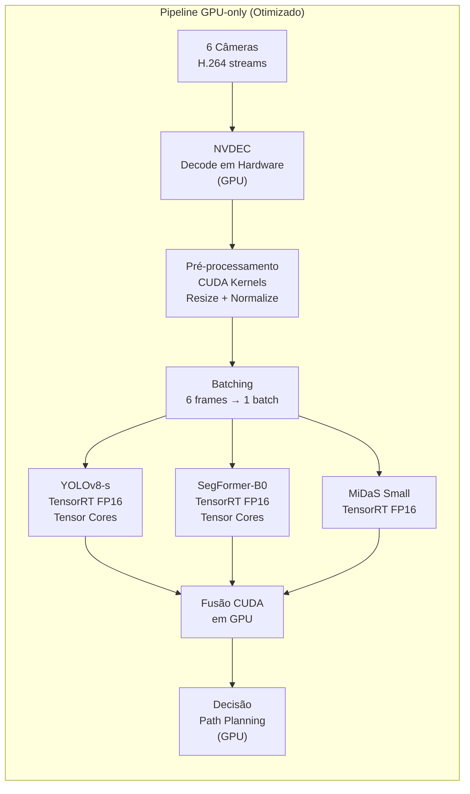
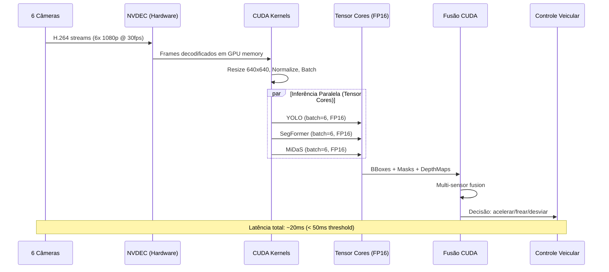
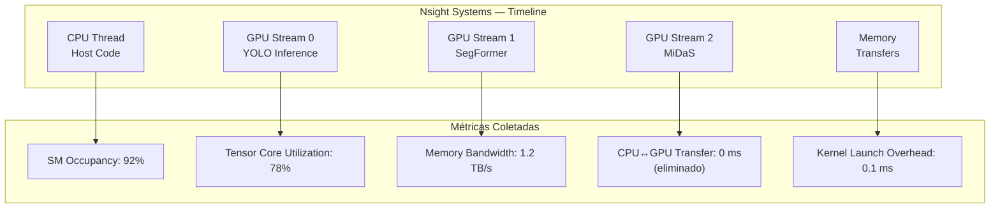

# Use Case — Aula 6: Veículo Autônomo — Processamento de Vídeo em Tempo Real

## Contexto da Aula

**Aula 6 — Aceleração com GPUs e TPUs**

---

## Cenário

A **AutoDrive Brasil** é uma empresa que desenvolve um sistema de **veículos autônomos nível 3** para transporte urbano. O sistema processa streams de múltiplas câmeras (6 câmeras) e sensores LIDAR simultaneamente, executando detecção de objetos, segmentação semântica e estimativa de profundidade em tempo real. O requisito crítico: **latência < 50ms por frame completo** (20+ FPS) para garantir segurança.

O pipeline original roda em **CPU** (Intel Xeon) para o pré-processamento e **GPU** (NVIDIA Orin) para inferência, mas a comunicação CPU↔GPU cria um gargalo severo, resultando em latência de **~120ms por frame** — mais que o dobro do aceitável.

---

## O Problema

```mermaid
gantt
    title Pipeline Original — Latência ~120ms/frame
    dateFormat X
    axisFormat %L ms

    section CPU
    Decode 6 câmeras       :a1, 0, 15
    Resize + Normalize      :a2, 15, 25
    Data Transfer CPU→GPU   :crit, a3, 25, 40

    section GPU
    Detecção (YOLO)         :a4, 40, 65
    Segmentação Semântica   :a5, 65, 85
    Depth Estimation        :a6, 85, 100

    section CPU (pós)
    Transfer GPU→CPU        :crit, a7, 100, 110
    Fusão + Decisão         :a8, 110, 120
```

| Gargalo | Tempo | % do Total |
|---------|-------|------------|
| **Transferência CPU↔GPU** | ~25ms | 21% |
| Decodificação em CPU | ~15ms | 12% |
| Pós-processamento em CPU | ~10ms | 8% |
| **Total overhead CPU** | **~50ms** | **42%** |

---

## Solução: Pipeline End-to-End GPU + Tensor Cores

---

## Comparação: CPU vs. GPU vs. Tensor Cores

| Etapa | CPU (Xeon) | GPU (CUDA Cores) | GPU (Tensor Cores FP16) | Speedup |
|-------|------------|-------------------|-------------------------|---------|
| Decode (6 cameras) | 15 ms | 2 ms (NVDEC) | 2 ms (NVDEC) | 7.5x |
| Resize + Normalize | 10 ms | 1.5 ms | 1.5 ms | 6.7x |
| Transfer CPU→GPU | 15 ms | 0 ms (já em GPU) | 0 ms | ∞ |
| Detecção YOLO | 25 ms | 12 ms | **5 ms** | 5.0x |
| Segmentação | 20 ms | 10 ms | **4 ms** | 5.0x |
| Depth Estimation | 15 ms | 8 ms | **3 ms** | 5.0x |
| Transfer GPU→CPU | 10 ms | 0 ms | 0 ms | ∞ |
| Fusão + Decisão | 10 ms | 4 ms | 4 ms | 2.5x |
| **Total** | **120 ms** | **37.5 ms** | **20.5 ms** | **5.9x** |

---

## Pipeline Completo com Mixed Precision

---

## Desafios Técnicos Abordados na Aula

| Desafio | Conceito da Aula 6 |
|---------|---------------------|
| Gargalo de transferência CPU↔GPU | Hierarquia de memória GPU; CUDA pinned memory; zero-copy buffers |
| Decodificação de vídeo lenta em CPU | NVDEC hardware decoder; decode direto em GPU memory |
| Inferência não explora hardware moderno | Tensor Cores: operações FP16/INT8 com throughput 8-16x vs. CUDA Cores |
| Precisão vs. velocidade | Mixed Precision Training/Inference: FP32 master weights + FP16 compute |
| Profiling de gargalos | NVIDIA Nsight Systems: timeline de CPU/GPU, identificar idle time |
| Múltiplos modelos concorrentes | CUDA Multi-Process Service (MPS); CUDA Streams para overlap |
| Porting para TPU (cloud training) | TPU v4: systolic arrays, bfloat16, XLA compilation |
| Monitoramento em produção | GPU utilization, memory bandwidth, thermal throttling |

---

## Profiling com Nsight Systems

---

## Tecnologias Relacionadas

- **GPU:** NVIDIA Orin (veículo), A100/H100 (cloud), Tensor Cores
- **TPU:** Google TPU v4, systolic arrays, bfloat16
- **Frameworks:** TensorRT (otimização FP16/INT8), CUDA, cuDNN
- **Mixed Precision:** NVIDIA Apex, PyTorch AMP (torch.cuda.amp)
- **Profiling:** Nsight Systems, Nsight Compute, nvidia-smi
- **Decode:** NVDEC (hardware video decoder)
- **Modelos:** YOLOv8, SegFormer, MiDaS

---

## Conexões com Outras Aulas

| Aula | Relação |
|------|---------|
| Aula 1 | P99 latência < 50ms como requisito de segurança |
| Aula 3 | CNN vs. ViT para detecção/segmentação; escolha de arquitetura por latência |
| Aula 4 | TensorRT aplica quantização PTQ INT8 nos modelos |
| Aula 5 | torch.compile para otimizar os modelos antes do TensorRT |
| Aula 7 | Multimodel serving: Triton gerenciando YOLO + SegFormer + MiDaS simultaneamente |

---

## Referências

- Markidis, S. et al. (2018). *NVIDIA Tensor Core Programmability, Performance & Precision*. IEEE IPDPS.
- Micikevicius, P. et al. (2018). *Mixed Precision Training*. ICLR.
- NVIDIA (2024). *TensorRT Developer Guide*.
- NVIDIA (2024). *Nsight Systems User Guide*.
- Jouppi, N. et al. (2023). *TPU v4: An Optically Reconfigurable Supercomputer*. ISCA.

---

📂 **Material da aula:** [Aula 6 — Aceleração com GPUs e TPUs](../../06_aceleracao_gpu_tpu/)
