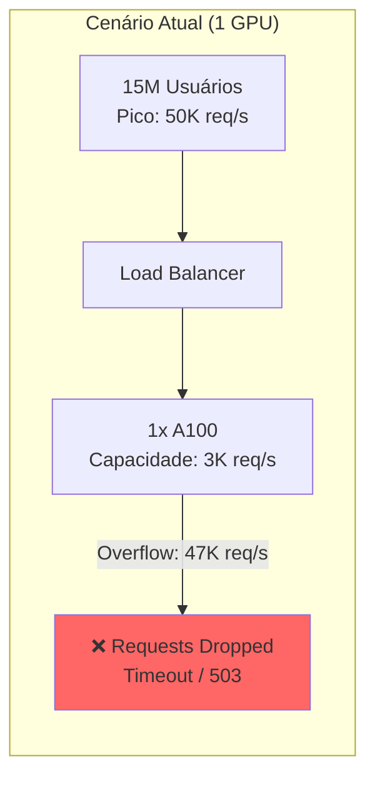
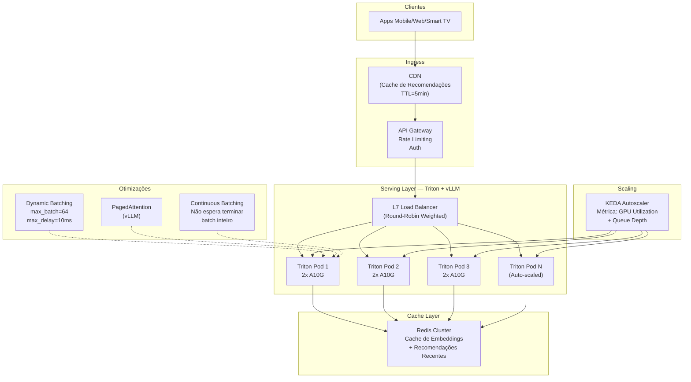
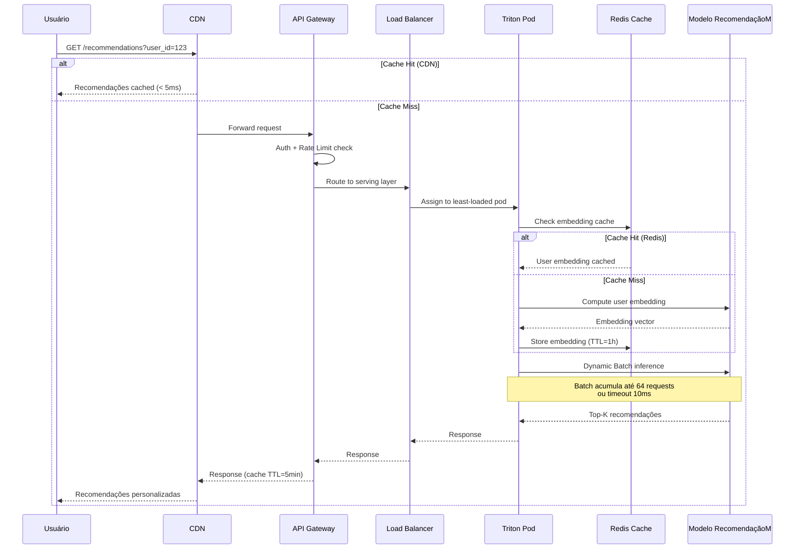
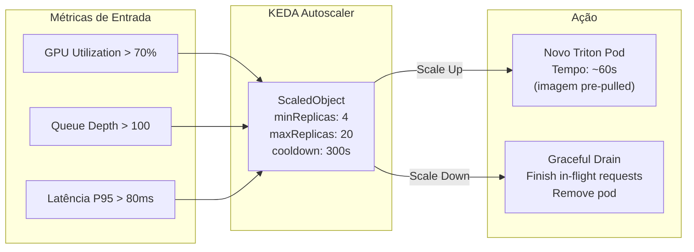

# Use Case — Aula 7: Plataforma de Recomendações — Serving Distribuído para Milhões de Usuários

## Contexto da Aula

**Aula 7 — Inferência Distribuída e Serving em Escala**

---

## Cenário

A **StreamFlix** é uma plataforma de streaming de vídeo com **15 milhões de usuários ativos** que opera um sistema de recomendação baseado em deep learning. O modelo de recomendação processa o histórico de visualização, preferências e contexto do usuário para gerar recomendações personalizadas em tempo real. Durante horários de pico (20h-23h), o sistema recebe até **50.000 requisições de inferência por segundo**.

O problema: um **único servidor GPU** (NVIDIA A100) consegue processar no máximo **~3.000 req/s** com latência aceitável (< 100ms P95). Para atender o pico de 50.000 req/s, é necessária uma infraestrutura de **serving distribuído** com auto-scaling inteligente.

---

## O Problema

| Métrica | Requisito | 1 GPU (Atual) | Gap |
|---------|-----------|---------------|-----|
| Throughput | 50.000 req/s | 3.000 req/s | 17x abaixo |
| Latência P95 | < 100 ms | 85 ms (sem carga) | OK isolado, degrada sob carga |
| Latência P95 (pico) | < 100 ms | > 2.000 ms | 20x acima |
| Disponibilidade | 99.9% | ~94% (drops no pico) | Inaceitável |
| Custo/req | Minimizar | — | — |

---

## Solução: Arquitetura de Serving Distribuído

---

## Fluxo de uma Requisição

---

## Comparação de Estratégias de Serving

| Estratégia | Throughput | Latência P95 | Custo Relativo | Complexidade |
|------------|------------|-------------- |----------------|--------------|
| 1 GPU, sem batching | 1.000 req/s | 50 ms | 1x | Baixa |
| 1 GPU, dynamic batching | 3.000 req/s | 85 ms | 1x | Baixa |
| **4 GPUs, dynamic batching** | 12.000 req/s | 90 ms | 4x | Média |
| **N GPUs + auto-scaling** | **50.000+ req/s** | **75 ms** | **~8x base** | Alta |
| N GPUs + CDN cache | 50.000+ req/s | **< 10 ms (cache hit)** | ~6x base | Alta |
| Continuous Batching (vLLM) | +40% vs. static | -20% vs. static | Mesmo | Média |
| PagedAttention (vLLM) | +2x memória efetiva | Similar | -30% GPUs | Média |

---

## Desafios Técnicos Abordados na Aula

| Desafio | Conceito da Aula 7 |
|---------|---------------------|
| Uma GPU não suporta o pico de requests | Inferência distribuída: model parallelism vs. data parallelism |
| Batching estático desperdiça latência | Dynamic batching: acumular requests até max_batch ou timeout |
| Modelos generativos bloqueiam o batch inteiro | Continuous batching: liberar slots conforme cada request termina |
| Memória GPU fragmentada em KV-cache | PagedAttention (vLLM): paginação virtual para KV-cache |
| Auto-scaling reativo demora para escalar | KEDA: scaling baseado em queue depth + GPU utilization |
| Orquestração de múltiplos modelos | Triton Inference Server: model versioning, ensemble pipelines |
| Deploy multi-cloud/hybrid | KServe: abstração de serving sobre Kubernetes |
| Monitoramento SLI/SLO em escala | Métricas: throughput, latência P50/P95/P99, error rate, GPU util |

---

## Escalonamento Automático

---

## Tecnologias Relacionadas

- **Serving:** Triton Inference Server, vLLM, TorchServe, KServe
- **Orquestração:** Kubernetes (AKS), KEDA (autoscaling)
- **Otimizações:** Dynamic Batching, Continuous Batching, PagedAttention
- **Cache:** Redis Cluster, CDN (Azure Front Door)
- **Monitoramento:** Prometheus, Grafana, Azure Monitor
- **Model Parallelism:** Tensor Parallelism, Pipeline Parallelism
- **Load Balancing:** NGINX, Envoy, Azure Application Gateway

---

## Conexões com Outras Aulas

| Aula | Relação |
|------|---------|
| Aula 1 | SLI/SLO: P95 < 100ms, throughput > 50K req/s, error rate < 0.1% |
| Aula 4 | Modelos quantizados (INT8) aumentam throughput por GPU em ~2x |
| Aula 5 | LoRA adapters permitem servir variantes do modelo sem duplicar memória |
| Aula 6 | Tensor Cores + TensorRT maximizam throughput por GPU |
| Aula 8 | Ensemble pipelines no Triton para orquestrar múltiplos modelos |

---

## Referências

- Crankshaw, D. et al. (2017). *Clipper: A Low-Latency Online Prediction Serving System*. NSDI.
- Kwon, W. et al. (2023). *Efficient Memory Management for Large Language Model Serving with PagedAttention*. SOSP.
- Yu, G. et al. (2022). *Orca: A Distributed Serving System for Transformer-Based Generative Models*. OSDI.
- NVIDIA (2024). *Triton Inference Server Documentation*.
- [KServe Documentation](https://kserve.github.io/website/)

---

📂 **Material da aula:** [Aula 7 — Inferência Distribuída e Serving em Escala](../../07_inferencia_distribuida/)
