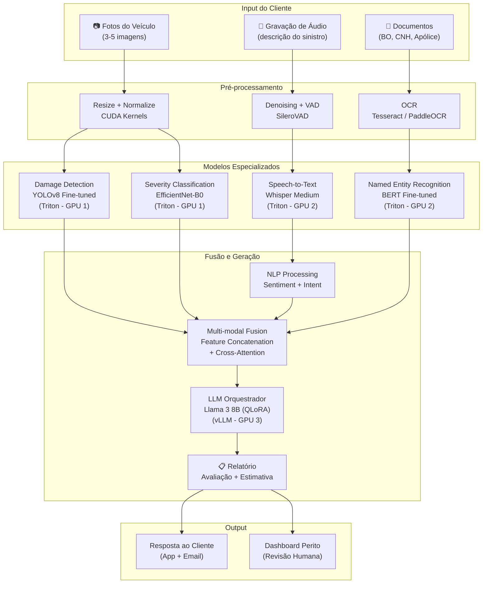
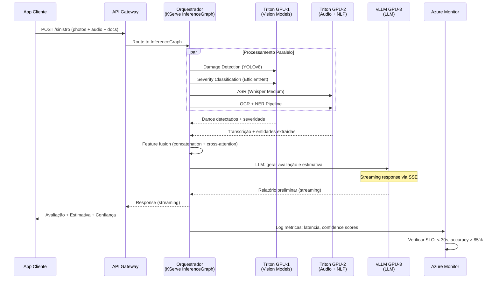
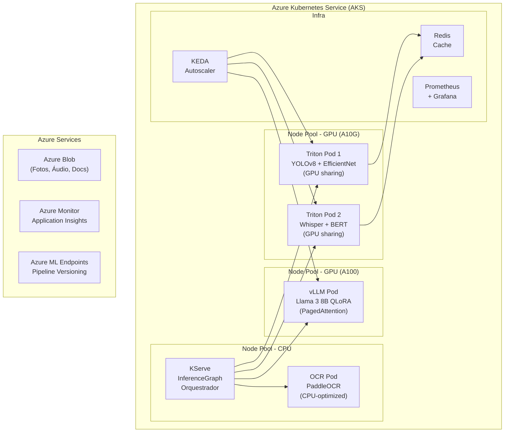

# Use Case — Aula 8: Assistente Virtual Multimodal — Orquestração de Modelos para Seguros

## Contexto da Aula

**Aula 8 — Orquestração de Modelos Multimodais**

---

## Cenário

A **SegurAI** é uma seguradora que implementa um **assistente virtual multimodal** para automatizar o processo de sinistros de automóveis. O cliente pode reportar um sinistro enviando **fotos do veículo danificado**, **gravação de áudio** descrevendo o incidente e **documentos escaneados** (boletim de ocorrência, CNH). O assistente deve processar todas essas modalidades simultaneamente, gerar uma avaliação preliminar do dano e estimar o valor da indenização — tudo em **menos de 30 segundos end-to-end**.

O desafio é orquestrar **5+ modelos especializados** (ASR, NLP, CV, OCR, LLM) em um pipeline coeso, garantindo que a latência total permaneça aceitável mesmo quando múltiplas modalidades são processadas.

---

## Pipeline Multimodal

---

## Orquestração: Sequencial vs. Paralelo

```mermaid
gantt
    title Comparação de Estratégias de Orquestração
    dateFormat X
    axisFormat %L s

    section Sequencial (Naive)
    OCR                     :a1, 0, 3000
    ASR (Whisper)           :a2, 3000, 8000
    NER                     :a3, 8000, 9000
    Damage Detection        :a4, 9000, 10500
    Severity Classification :a5, 10500, 11500
    NLP Processing          :a6, 11500, 12500
    LLM Fusion + Report     :a7, 12500, 17500
    Total                   :crit, 17500, 17500

    section Paralelo (Otimizado)
    OCR                     :b1, 0, 3000
    ASR (Whisper)           :b2, 0, 5000
    Damage Detection        :b3, 0, 1500
    Severity Classification :b4, 0, 1000
    NER (após OCR)          :b5, 3000, 4000
    NLP (após ASR)          :b6, 5000, 6000
    LLM Fusion + Report     :b7, 6000, 11000
    Total                   :crit, 11000, 11000
```

| Estratégia | Latência Total | Utilização GPU | Complexidade |
|------------|---------------|----------------|--------------|
| Sequencial | ~17.5s | ~25% (idle entre modelos) | Baixa |
| **Paralelo (DAG)** | **~11s** | **~70%** | Média |
| Paralelo + Cache | ~8s (cache hit parcial) | ~65% | Alta |
| Paralelo + Streaming | ~11s (TTFR: 3s) | ~75% | Alta |

---

## Fluxo Detalhado com KServe + Triton

---

## Latência por Componente

| Modelo | Hardware | Latência P50 | Latência P95 | Throughput |
|--------|----------|-------------- |-------------- |------------|
| YOLOv8 (Damage) | GPU 1 (A10G) | 120 ms | 180 ms | 200 img/s |
| EfficientNet-B0 (Severity) | GPU 1 (A10G) | 80 ms | 120 ms | 350 img/s |
| Whisper Medium (ASR) | GPU 2 (A10G) | 3.5 s | 5.0 s | Real-time factor: 0.3x |
| BERT (NER) | GPU 2 (A10G) | 15 ms | 25 ms | 800 req/s |
| OCR (PaddleOCR) | CPU | 2.0 s | 3.0 s | — |
| Llama 3 8B QLoRA (LLM) | GPU 3 (A100) | 4.0 s | 5.5 s | 50 tokens/s |
| **Total (paralelo)** | — | **~9.0 s** | **~11.5 s** | — |

---

## Desafios Técnicos Abordados na Aula

| Desafio | Conceito da Aula 8 |
|---------|---------------------|
| Orquestrar 5+ modelos de diferentes modalidades | DAG de inferência: dependências, paralelismo, fusão |
| Pipeline sequencial é muito lento | KServe InferenceGraph: orquestração declarativa com paralelismo |
| Cada modelo tem requisitos diferentes de GPU | Multi-model serving: Triton ensembles, model placement |
| Monitorar pipeline multimodal end-to-end | SLI/SLO: latência E2E < 30s, accuracy > 85%, availability 99.9% |
| Latência do ASR domina o pipeline | Streaming ASR: enviar transcrição parcial para antecipar NLP |
| Deploy reprodutível do pipeline | KServe + Kubernetes: declarative, versioned, auto-scaled |
| Versionamento de pipeline (não só modelo) | Azure ML Endpoints: pipeline versioning, A/B testing |
| Custo de múltiplas GPUs | Model co-location, GPU sharing, spot instances |

---

## Diagrama de Deployment

---

## SLI/SLO do Pipeline

| SLI (Indicador) | SLO (Objetivo) | Alerting Threshold |
|------------------|-----------------|---------------------|
| Latência E2E P95 | < 30 segundos | > 25 segundos |
| Latência E2E P50 | < 15 segundos | > 12 segundos |
| Damage Detection Accuracy | > 90% | < 87% |
| ASR Word Error Rate | < 15% | > 18% |
| Estimativa de Valor (MAE) | < R$ 500 | > R$ 750 |
| Disponibilidade | 99.9% | < 99.5% |
| Error Rate | < 0.5% | > 1.0% |

---

## Tecnologias Relacionadas

- **Orquestração:** KServe InferenceGraph, Azure ML Endpoints, Triton Ensembles
- **Serving:** Triton Inference Server, vLLM, TorchServe
- **Modelos:** YOLOv8, EfficientNet, Whisper, BERT, Llama 3, PaddleOCR
- **Infraestrutura:** AKS, KEDA, Helm Charts
- **Monitoramento:** Prometheus, Grafana, Azure Monitor, Application Insights
- **Cache:** Redis Cluster (embeddings + resultados intermediários)
- **Storage:** Azure Blob Storage (multimodal artifacts)

---

## Conexões com Outras Aulas

| Aula | Relação |
|------|---------|
| Aula 1 | Budget de latência distribuído entre componentes do pipeline |
| Aula 2 | Whisper ASR + Flash Attention para transcrição eficiente |
| Aula 3 | YOLOv8 + EfficientNet para detection e classification |
| Aula 4 | Modelos quantizados (INT8) para reduzir footprint de GPU |
| Aula 5 | LLM com QLoRA para domínio de seguros |
| Aula 6 | Tensor Cores para inferência FP16 em todos os modelos |
| Aula 7 | Triton + vLLM + KEDA para serving distribuído |

---

## Referências

- Reed, S. et al. (2022). *A Generalist Agent (Gato)*. arXiv.
- Driess, D. et al. (2023). *PaLM-E: An Embodied Multimodal Language Model*. ICML.
- Liu, H. et al. (2023). *Visual Instruction Tuning (LLaVA)*. NeurIPS.
- KServe (2024). *InferenceGraph Documentation*.
- Microsoft (2024). *Azure ML Managed Online Endpoints*.

---

📂 **Material da aula:** [Aula 8 — Orquestração de Modelos Multimodais](../../08_orquestracao_multimodal/)

---

📊 **Business Case detalhado:** [Business Case — Assistente Multimodal para Seguros](./business-case-multimodal-assistant.md)
